# Nhóm 2 — Bài thực hành Responsive, jQuery và Flappy Bird

- Môn học: **Phát triển ứng dụng WEB/TMĐT**.
- Ngày hoàn thiện: **24/11/2026**.
- Đề bài: [BaiThucHanh_Responsive_JQuery.pdf](BaiThucHanh_Responsive_JQuery.pdf).
- Trang mở bài: [index.html](index.html).
- Hướng dẫn chạy: [README.md](README.md).

Bài làm gồm đủ ba phần trong đề. Toàn bộ thư viện và ảnh được lưu cục bộ; không cần tải CDN khi sử dụng. Website e-commerce là mô phỏng frontend, không thực hiện giao dịch hay thanh toán thật.

## 1. Hoàn thiện e-commerce — MÈO HOME

### Mô tả đề bài

Xây dựng website bán hàng theo hướng dẫn Bootstrap được liên kết trong PDF; tự chọn loại hình kinh doanh và thay nội dung tương ứng. Bổ sung chọn/zoom ảnh bằng **xZoom**, trạng thái kho bằng **Bootstrap progress**, phần trăm giảm giá ở góc trên trái, nhãn **New / Best seller** ở góc trên phải, và thay toàn bộ sao tĩnh bằng **bootstrap-star-rating**.

### Cách thực hiện

Chọn mô hình **MÈO HOME — đồ dùng nhà bếp**, với sáu sản phẩm: chảo, máy xay sinh tố, bình nước, nồi gang, bộ dụng cụ dao và túi vải. Dữ liệu giá, thông số và tồn kho phục vụ bài thực hành; ảnh và sơ đồ minh họa có nguồn ghi trong [THIRD_PARTY.md](THIRD_PARTY.md).

| Yêu cầu | Phần đã thực hiện |
|---|---|
| Giao diện responsive | Navbar thu gọn trên mobile, danh mục cuộn ngang, lưới sản phẩm thích ứng theo chiều rộng. |
| Chức năng cơ bản theo hướng dẫn | Navbar, carousel có điều khiển, danh mục, tìm kiếm, sắp xếp, trang chi tiết, giỏ hàng, đánh giá và trạng thái đơn demo. |
| Chọn và zoom ảnh | Thư viện xZoom thật; chọn giữa ảnh sản phẩm và sơ đồ minh họa, zoom bên trong ảnh chính. |
| Trạng thái kho | `.progress` / `.progress-bar`, có `role="progressbar"`, giá trị ARIA và nhãn số lượng đã bán/còn lại. |
| Giảm giá / nhãn sản phẩm | Phần trăm giảm được tính từ giá gốc và giá bán; badge giảm bên trái, New/Best seller bên phải. |
| Thay glyphicon-star | Tất cả đánh giá dùng bootstrap-star-rating với theme `krajee-svg`, gồm sao hiển thị và bộ chọn sao của form. |
| Chọn mua | Chọn kích thước/dung tích, màu sắc và số lượng; tổng lượng của cùng mã không vượt tồn kho dù chọn nhiều biến thể. |
| Giỏ hàng / đơn | Sửa số lượng, xóa, tính tổng, lưu giỏ khi tải lại và tạo/chuyển trạng thái đơn demo trong trình duyệt. |
| Nhận xét | Dùng widget sao thật; nội dung được hiển thị như văn bản, không chèn HTML người dùng và không lưu tên/nhận xét lâu dài. |

Phần trăm giảm giá được tính bằng `round((1 - giá_bán / giá_gốc) × 100)`. Thanh kho dùng tỉ lệ `đã_bán / (đã_bán + còn_lại) × 100`; luôn kèm số lượng bằng chữ để người xem không phải suy ra chỉ từ màu.

Khởi tạo xZoom trong [product.js](ecommerce/product.js):

```javascript
$('.xzoom, .xzoom-gallery').xzoom({
  position: 'inside', adaptive: true, title: false, scroll: false
});
```

Các trang chính: [Danh mục](ecommerce/index.html), [Chi tiết](ecommerce/product.html?id=pot), [Giỏ hàng](ecommerce/cart.html), [Đơn hàng demo](ecommerce/orders.html).

### Ảnh minh chứng

**Danh mục trên desktop:** đủ badge, sao đánh giá và trạng thái kho.

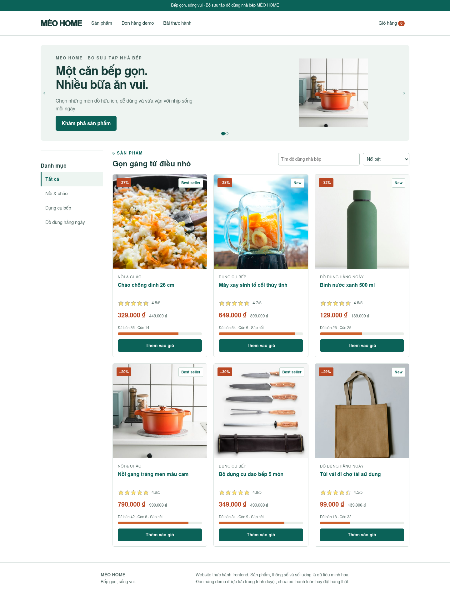

**Chọn ảnh và zoom với xZoom:**

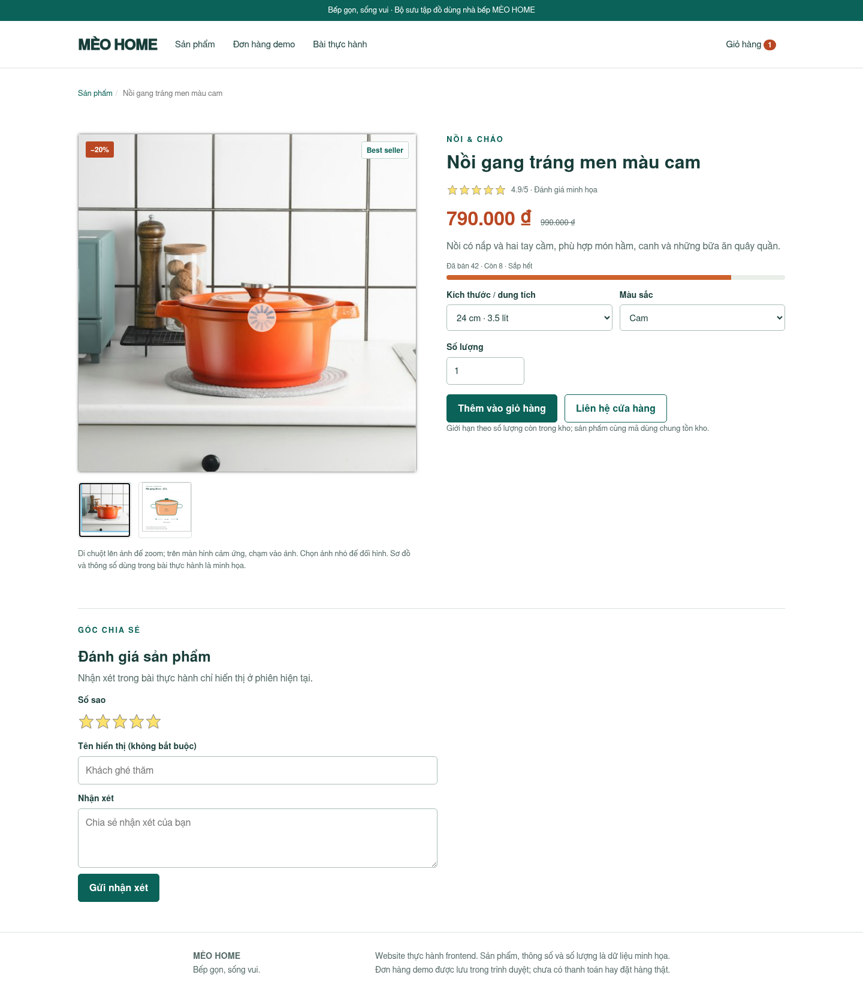

**Chi tiết, tùy chọn mua và nhận xét bằng thư viện sao:**

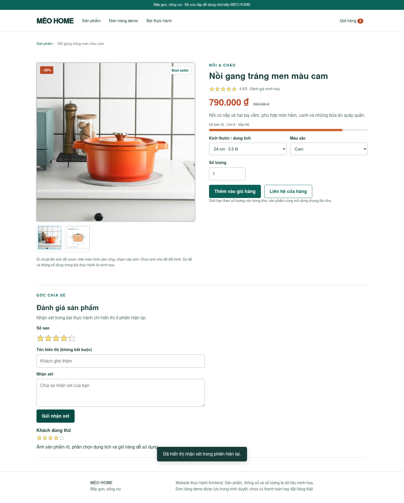

**Giỏ hàng và đơn demo:**

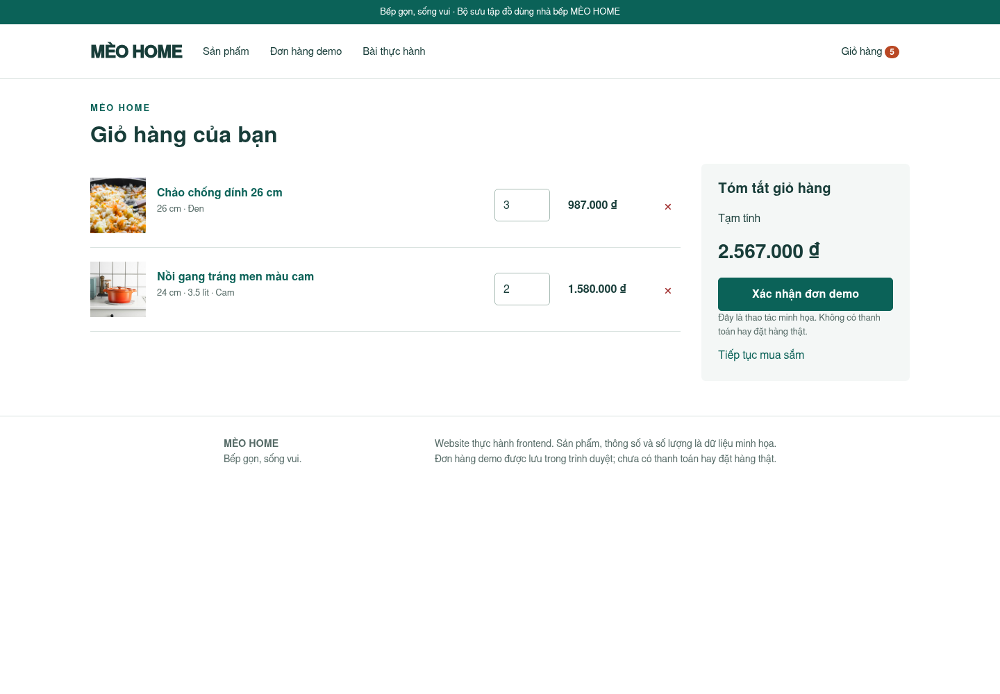

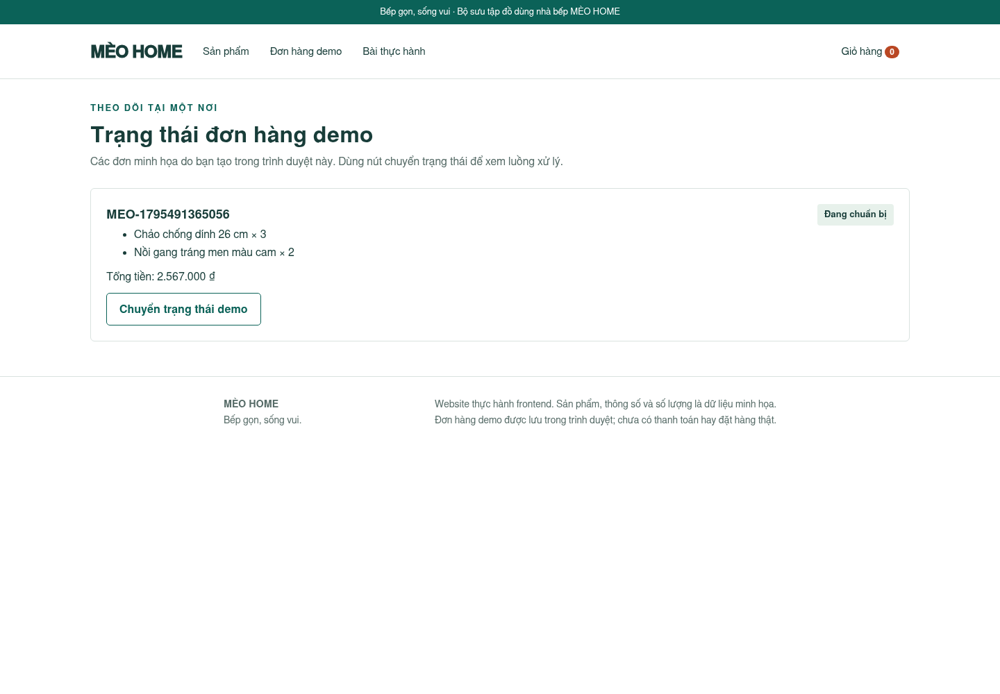

**Giao diện mobile:**

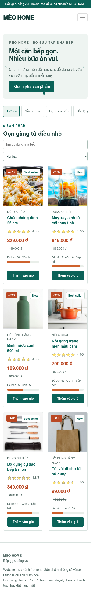

## 2. jQuery — Bài tập và deadline trên LMS

### Mô tả đề bài

In ra bài nộp thứ năm của lớp; liệt kê mọi chủ đề, cho biết chủ đề có bài tập hay không và hạn nộp của từng bài. Không bỏ qua chủ đề không có bài tập, chẳng hạn “Tài liệu tham khảo”.

### Nguồn dữ liệu và cách thực hiện

Dữ liệu thật được đọc từ [lớp LMS UEH 43858](https://lms.ueh.edu.vn/course/view.php?id=43858) trong tab Chrome đã đăng nhập ngày **24/11/2026**. Chỉ giữ thông tin khóa học, tên chủ đề, bài tập, liên kết bài và hạn nộp; không lưu thông tin đăng nhập, điểm hay bài nộp cá nhân.

Trang lớp có **14 chủ đề và 16 bài tập**. Dữ liệu đọc được được lưu tại [course-data.js](jquery-lms/course-data.js). Trang [jquery-lms/index.html](jquery-lms/index.html) tái hiện DOM từ dữ liệu này và chạy chính bộ phân tích jQuery để kiểm chứng; giao diện ghi rõ đây là trang thống kê local, không phải LMS gốc.

Script [lms-console.js](jquery-lms/lms-console.js) có thể chạy trực tiếp trong Console của trang lớp. Script dùng jQuery đang có trên trang hoặc module AMD `jquery` của Moodle; chỉ đọc DOM và in kết quả, không sửa hay nộp dữ liệu LMS.

### Bài nộp thứ năm

jQuery đánh chỉ số từ 0, nên bài thứ năm phải dùng **`.eq(4)`**:

```javascript
$('.modtype_assign').eq(4).find('.instancename').each(function () {
  console.log($(this).text());
});
```

**Kết quả:** [Bài tập nhóm chương 1 - Về nhà](https://lms.ueh.edu.vn/mod/assign/view.php?id=1176537), hạn **20/10/2026 lúc 23:00**, theo thời gian hiển thị của LMS.

### Thống kê mọi chủ đề

| Chủ đề | Có bài tập? | Bài tập và hạn nộp |
|---|---|---|
| Chung | Có, 2 bài | [Đăng ký và Nộp nội dung thuyết trình](https://lms.ueh.edu.vn/mod/assign/view.php?id=1163673) — **Không hiển thị hạn**, kể cả trang chi tiết<br><br>[Nộp chứng chỉ liên quan đến môn học](https://lms.ueh.edu.vn/mod/assign/view.php?id=1163674) — **Không hiển thị hạn**, kể cả trang chi tiết |
| Thông báo | Không | Không có bài tập nộp. |
| Tài liệu tham khảo | Không | Không có bài tập nộp. |
| GIới thiệu môn học | Không | Không có bài tập nộp. |
| Tổng quan | Có, 3 bài | [Bài tập cá nhân chương 1 - Trên lớp](https://lms.ueh.edu.vn/mod/assign/view.php?id=1175488) — Hạn: **14/10/2026 23:30**<br><br>[Bài tập cá nhân chương 1 - Về nhà](https://lms.ueh.edu.vn/mod/assign/view.php?id=1176536) — Hạn: **20/10/2026 23:00**<br><br>[Bài tập nhóm chương 1 - Về nhà](https://lms.ueh.edu.vn/mod/assign/view.php?id=1176537) — Hạn: **20/10/2026 23:00** |
| HTML | Có, 3 bài | [Bài tập cá nhân chương 2 - Về nhà](https://lms.ueh.edu.vn/mod/assign/view.php?id=1181993) — Hạn: **03/11/2026 23:00**<br><br>[Bài tập nhóm chương 2 - Về nhà](https://lms.ueh.edu.vn/mod/assign/view.php?id=1181994) — Hạn: **03/11/2026 23:00**<br><br>[Bài tập cá nhân chương 2 - Trên lớp](https://lms.ueh.edu.vn/mod/assign/view.php?id=1181679) — Hạn: **21/10/2026 12:30** |
| Tổng quan CSS | Có, 3 bài | [Bài tập cá nhân chương 3 - Trên lớp](https://lms.ueh.edu.vn/mod/assign/view.php?id=1190955) — Hạn: **04/11/2026 12:30**<br><br>[Bài tập cá nhân chương 3 - Về nhà](https://lms.ueh.edu.vn/mod/assign/view.php?id=1163695) — Hạn: **11/11/2026 23:00**<br><br>[Bài tập nhóm chương 3 - Về nhà - New](https://lms.ueh.edu.vn/mod/assign/view.php?id=1197010) — Hạn: **18/11/2026 23:00** |
| Advance Font-end | Có, 2 bài | [Bài tập trên lớp: Advance Font-end](https://lms.ueh.edu.vn/mod/assign/view.php?id=1163706) — Hạn: **18/11/2026 12:00**<br><br>[Bài tập về nhà: Advance Font-end](https://lms.ueh.edu.vn/mod/assign/view.php?id=1163707) — Hạn: **24/11/2026 23:00** |
| JS | Có, 2 bài | [Bài tập cá nhân JS - Về nhà - New](https://lms.ueh.edu.vn/mod/assign/view.php?id=1196749) — Hạn: **18/11/2026 23:00**<br><br>[Bài tập cá nhân Buổi 4 - Trên lớp](https://lms.ueh.edu.vn/mod/assign/view.php?id=1194676) — Hạn: **11/11/2026 12:30** |
| Tự học LMS | Có, 1 bài | [Hoàn thành bài Lab Back-End](https://lms.ueh.edu.vn/mod/assign/view.php?id=1163719) — Hạn: **30/11/2026 23:00** |
| Back_End | Không | Không có bài tập nộp. |
| Chủ đề 11 *(nhãn dự phòng)* | Không | Không có bài tập nộp. |
| Chủ đề 12 *(nhãn dự phòng)* | Không | Không có bài tập nộp. |
| Chủ đề 13 *(nhãn dự phòng)* | Không | Không có bài tập nộp. |

Có **14 bài hiện deadline**. Hai bài đầu không hiển thị hạn ngay cả khi mở trang chi tiết, nên báo cáo không suy đoán ngày nộp. Ba chủ đề cuối chưa có heading trong dữ liệu được sao chép; nhãn “Chủ đề 11/12/13” là nhãn dự phòng, được ghi rõ trong dữ liệu.

Khi xử lý ngày, script lấy trường **Due / Hạn nộp**, không lấy ngày **Opened / Mở bài**. Các thời điểm được giữ theo hiển thị LMS, không tự chuyển múi giờ. Ví dụ ngày `12:00 PM` được hiểu là 12 giờ trưa; `12:00 AM` là 0 giờ.

### Ảnh kết quả

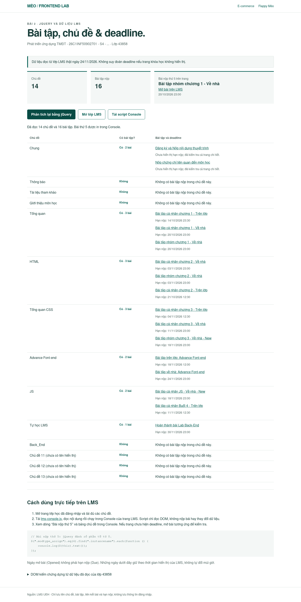

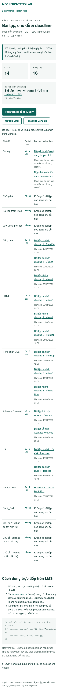

## 3. Hoàn thiện game — Flappy Mèo

### Mô tả đề bài

Cá nhân hóa hình Bird và ống; hiển thị Level ở góc trên trái. Đạt 5/20/40 điểm lần lượt lên Level 2/3/4, dùng interval 40/30/25/20 ms tương ứng. Đạt 50 điểm phải dừng và hiện chiến thắng. Thay thao tác mousedown bằng **keydown ArrowDown**; cải thiện độ mượt và đề xuất tính năng nâng cao.

### Cách thực hiện

Trò chơi tại [flappy-bird/index.html](flappy-bird/index.html) dùng **Chim Mèo** màu cam, cánh teal và **ống gốm** tự thiết kế bằng SVG. Phần logic độc lập ở [engine.js](flappy-bird/engine.js); điều khiển, hiển thị và vòng lặp ở [game.js](flappy-bird/game.js).

| Điểm | Level hiển thị | Interval mô phỏng | Kết quả |
|---|---|---|---|
| 0–4 | 1 | 40 ms | Khởi đầu |
| 5–19 | 2 | 30 ms | Tăng tốc độ ống |
| 20–39 | 3 | 25 ms | Tăng tốc tiếp |
| 40–49 | 4 | 20 ms | Chặng cuối |
| 50 | 4 | Dừng cập nhật vật lý và điểm | Hiện “Chiến thắng!” |

- **Điều khiển:** bắt sự kiện `keydown` với `event.code === 'ArrowDown'`; chặn cuộn trang và chỉ tạo một nhịp bay cho mỗi lần nhấn. Không dùng mousedown để điều khiển chim.
- **Độ mượt:** `requestAnimationFrame` để vẽ theo màn hình; mô phỏng theo bước thời gian cố định và nội suy giữa hai trạng thái. Tốc độ tăng theo interval nhưng trọng lực tính theo thời gian thực.
- **Va chạm và điểm:** kiểm tra ống, trần và mặt đất; mỗi cặp ống chỉ cộng một điểm. Xử lý va chạm trước chiến thắng để không nhận thắng nếu đụng đất cùng khung hình.
- **Cải tiến:** khe ống dễ quan sát, thay đổi độ cao có giới hạn, chế độ luyện tập mở rộng khe, tạm dừng/tiếp tục bằng P, chơi lại bằng R, tự tạm dừng khi chuyển cửa sổ và lưu kỷ lục cục bộ.
- **Mobile:** nút Bay lên bổ sung cho thiết bị cảm ứng; thao tác bàn phím ArrowDown vẫn là điều khiển chính theo đề.

### Ảnh minh chứng

**Màn hình bắt đầu với hình ảnh cá nhân hóa:**


**Tạm dừng và trạng thái thua:**

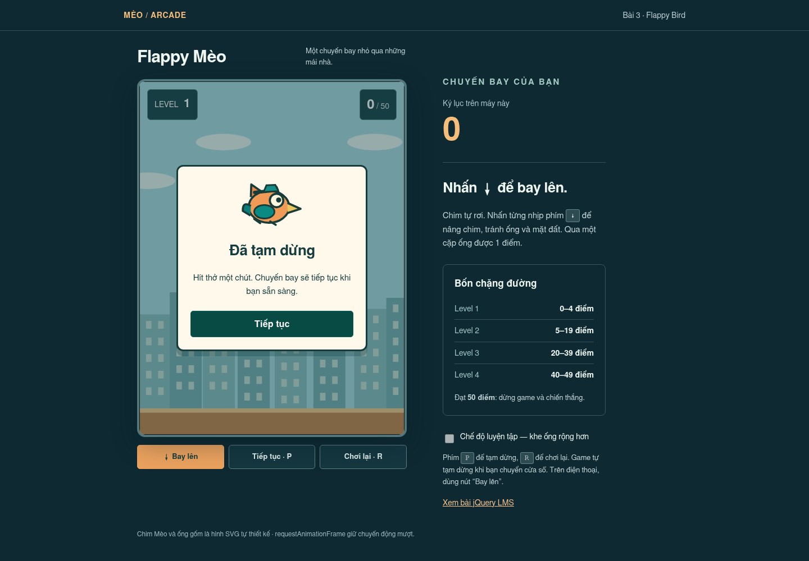

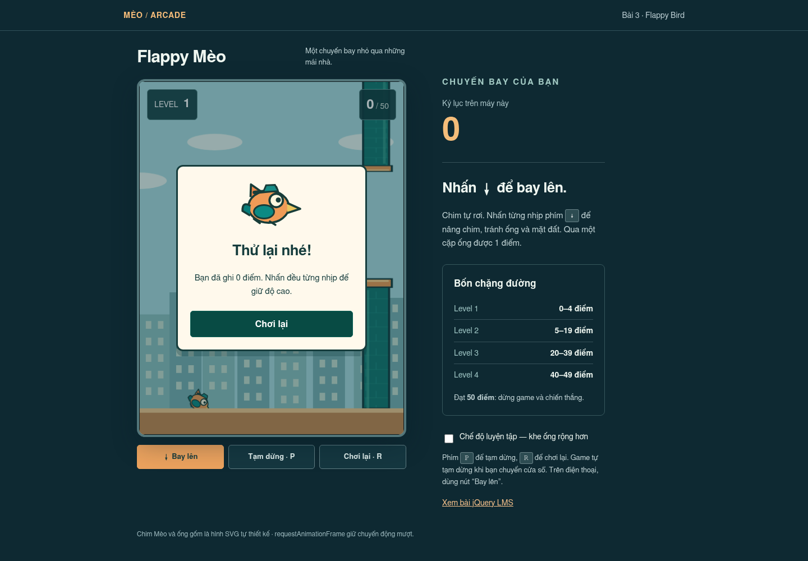

**Lên level qua các mốc điểm:**

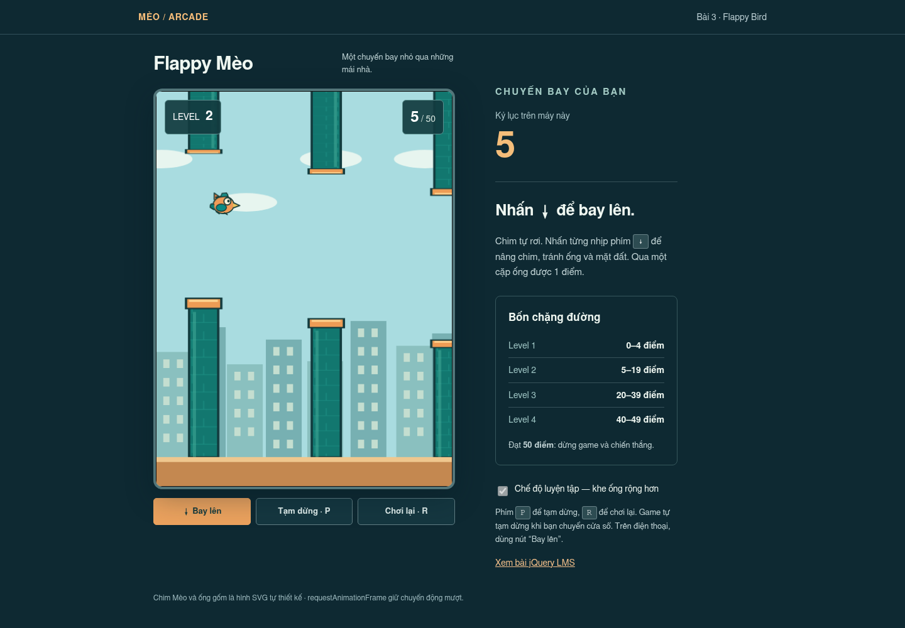

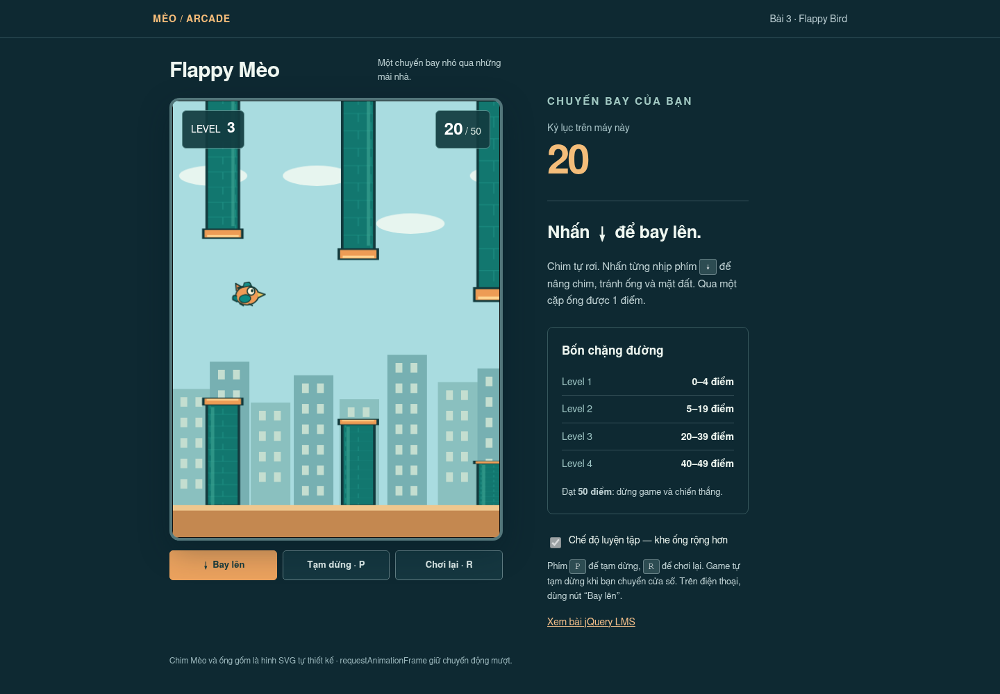

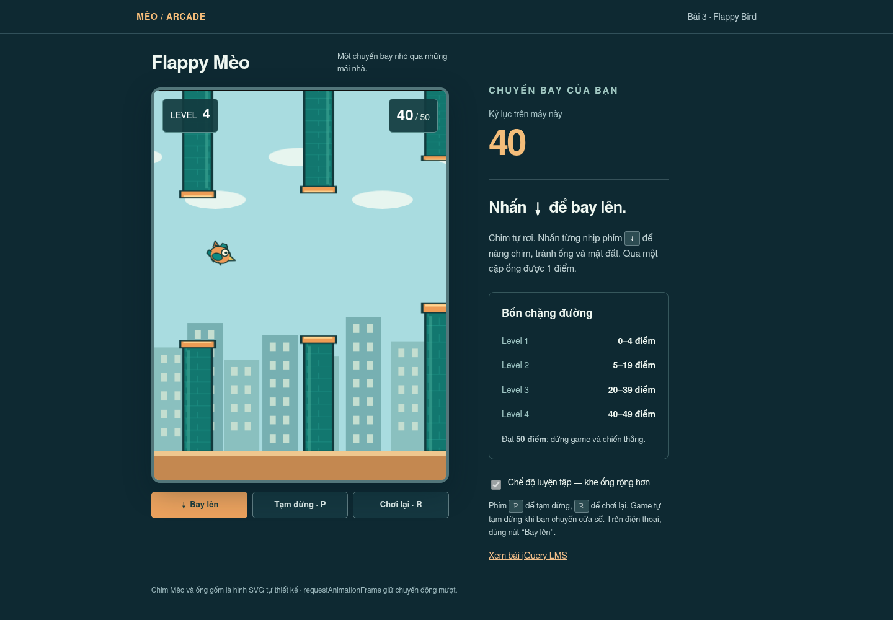

**Đạt 50 điểm và chiến thắng:** ảnh chụp khi kiểm thử chơi thật bằng phím ArrowDown ở **chế độ luyện tập**. Chế độ này chỉ tăng độ rộng khe; các mốc điểm, interval và điều kiện thắng giữ nguyên. Không sửa điểm hay ép trạng thái để tạo ảnh.

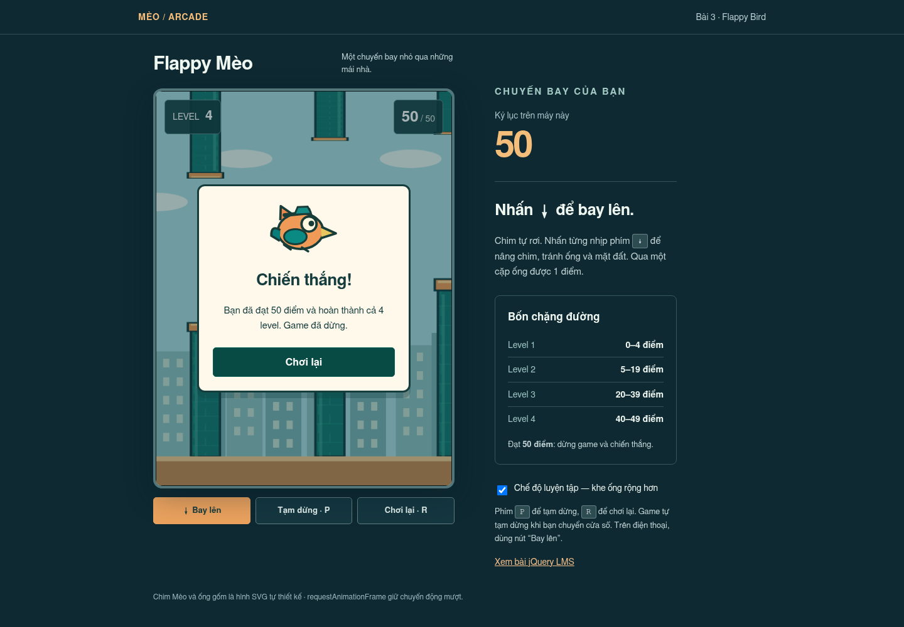

## 4. Kiểm tra kết quả

- **12 kiểm thử logic đạt**, gồm tính giảm giá, tồn kho/biến thể, dữ liệu giỏ hỏng, mốc level, va chạm, tạm dừng, điểm 50 và xử lý ngày Due/Opened/AM/PM.
- **6 nhóm kiểm tra trình duyệt đạt**: danh mục; chi tiết/zoom/đánh giá; giỏ/đơn; LMS; responsive; chơi game đến chiến thắng.
- Kiểm tra 7 trang ở **320, 768, 1024, 1440 px**, không tràn ngang toàn trang. Bảng LMS có vùng cuộn riêng khi cần.
- Đã kiểm tra đổi ảnh và zoom thật, thay sao bằng bàn phím, sửa giỏ và tải lại, tạo đơn, hiển thị nhận xét như văn bản và xử lý trang sản phẩm không tồn tại.
- Không ghi nhận lỗi JavaScript hoặc tài nguyên local bị thiếu trong lượt kiểm thử hoàn tất.
- Kiểm tra game dùng phím điều khiển thật tới 50 điểm; sau thắng, snapshot vật lý/điểm không tiếp tục thay đổi.

Lệnh kiểm tra logic: `npm test`. Kịch bản trình duyệt: [tests/browser.cjs](tests/browser.cjs); kết quả: [tests/browser-results.json](tests/browser-results.json). Xem [README.md](README.md) để chạy lại.

## 5. Tài liệu và nguồn tham khảo

- [Hướng dẫn làm website bằng Bootstrap — tài liệu được liên kết trong đề](https://drive.google.com/file/d/1PO0UX2Wnx7u4Q1acoCDxlQumsNo0hO8s/view).
- [Bootstrap 3.4 — Progress bars](https://getbootstrap.com/docs/3.4/components/#progress).
- [xZoom — tài liệu chính thức](https://payalord.github.io/xZoom/).
- [bootstrap-star-rating — tài liệu chính thức](https://plugins.krajee.com/star-rating), [mã nguồn và giấy phép](https://github.com/kartik-v/bootstrap-star-rating).
- [jQuery `.eq()`](https://api.jquery.com/eq/), [`.each()`](https://api.jquery.com/each/), [`.on()`](https://api.jquery.com/on/).
- [Moodle — dùng jQuery qua AMD](https://moodledev.io/docs/4.5/guides/javascript/jquery). Bài này dùng jQuery theo yêu cầu đề thực hành.
- [Freetuts — bài Flappy Bird được liên kết trong đề](https://freetuts.net/viet-game-flappy-bird-don-gian-voi-html-css-va-jquery-713.html): tham khảo mô hình chim, cặp ống, ghi điểm và va chạm; phần game trong bài làm được viết lại với vòng lặp và các yêu cầu nâng cao.
- [MDN — requestAnimationFrame](https://developer.mozilla.org/en-US/docs/Web/API/Window/requestAnimationFrame).
- [THIRD_PARTY.md](THIRD_PARTY.md): nguồn ảnh, phiên bản thư viện, giấy phép và lưu ý Bootstrap 3 dành cho bài thực hành.
