# Nhóm 3 — Bài làm Flexbox Froggy

- Trò chơi: [Flexbox Froggy](https://flexboxfroggy.com/).
- Ngày thực hiện: 23/11/2026.
- Kết quả: hoàn thành **24/24 level** trên Google Chrome.
- Mỗi ảnh được chụp trực tiếp sau khi game chấp nhận mã CSS và các ếch nằm trên lá sen đúng màu.
- Phạm vi báo cáo này: bài Flexbox Froggy trong Nhóm 3.

## Kết quả hoàn thành

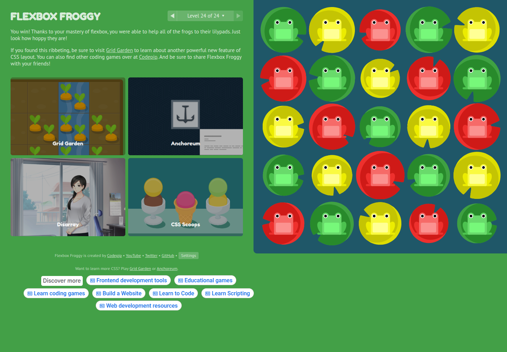

## Level 1

**Mô tả đề bài:** Đưa ếch xanh đến lá sen nằm ở phía trên bên phải ao. Bài yêu cầu dùng `justify-content` để thay đổi vị trí của ếch theo chiều ngang.

**Cách làm:** Thêm `justify-content: flex-end;` vào `#pond`. Với hướng hàng mặc định, trục chính chạy từ trái sang phải nên `flex-end` đưa ếch về mép phải, trùng với lá sen.

```css
#pond {
  display: flex;

  justify-content: flex-end;
}
```

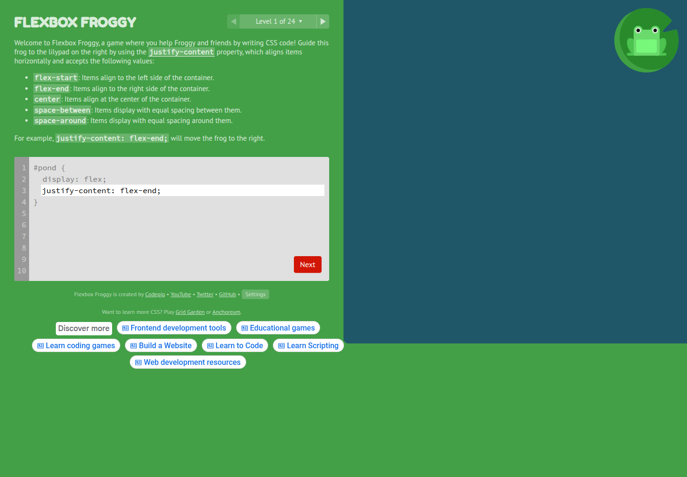

## Level 2

**Mô tả đề bài:** Đưa hai ếch xanh và vàng đến hai lá sen nằm cạnh nhau ở giữa phía trên ao. Cần căn giữa cả nhóm ếch theo chiều ngang.

**Cách làm:** Dùng `justify-content: center;` cho `#pond`. Thuộc tính này gom hai ếch thành một nhóm ở giữa trục chính, giữ nguyên thứ tự xanh rồi vàng để khớp màu lá sen.

```css
#pond {
  display: flex;

  justify-content: center;
}
```

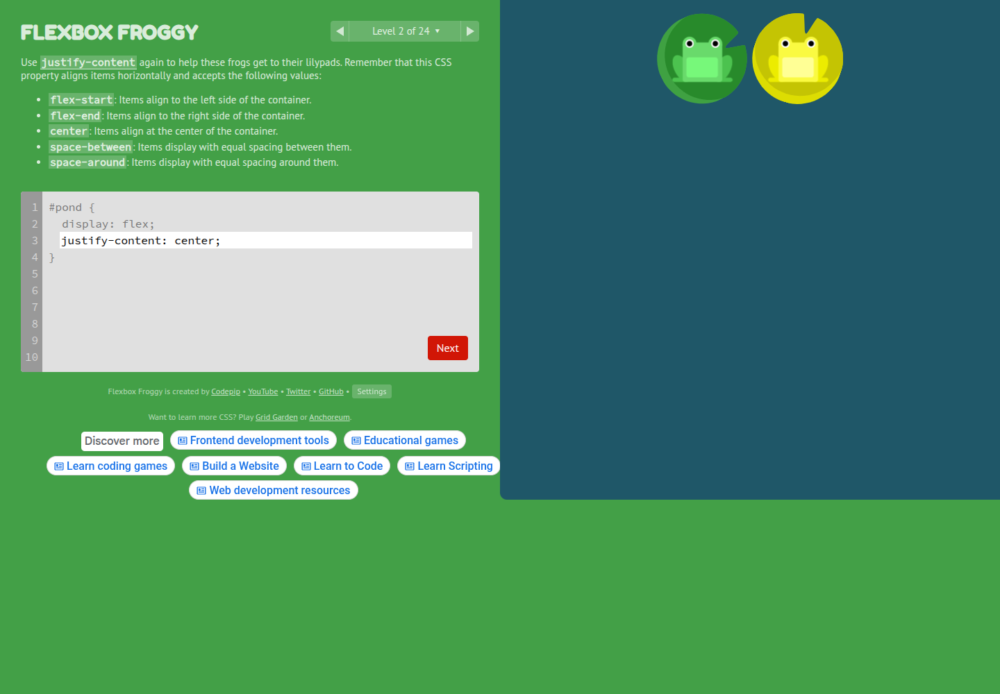

## Level 3

**Mô tả đề bài:** Đưa ba ếch xanh, vàng và đỏ đến các lá sen phân bố trên hàng ngang phía trên ao. Mỗi lá sen có khoảng trống ở hai bên nên cần giãn các ếch ra tương ứng.

**Cách làm:** Đặt `justify-content: space-around;`. Mỗi ếch được phân bổ khoảng trống bằng nhau ở hai bên; khoảng cách giữa hai ếch vì vậy gấp đôi khoảng trống ở mép ao, giúp chúng khớp vị trí các lá sen.

```css
#pond {
  display: flex;

  justify-content: space-around;
}
```

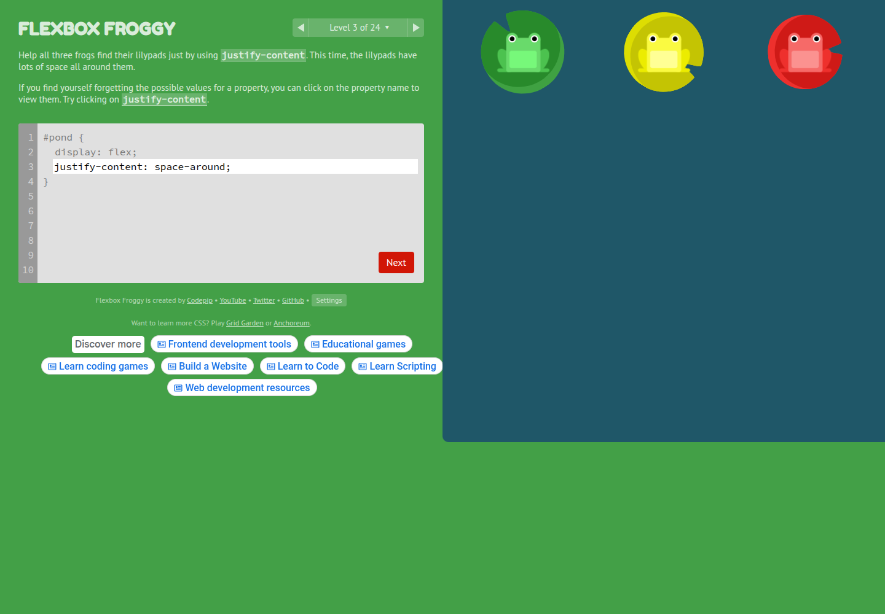

## Level 4

**Mô tả đề bài:** Đưa ba ếch đến ba lá sen nằm ở bên trái, chính giữa và bên phải của hàng trên cùng. Hai ếch ngoài cùng cần nằm sát hai đầu vùng bố trí.

**Cách làm:** Dùng `justify-content: space-between;`. Flexbox đặt ếch đầu ở đầu trục chính, ếch cuối ở cuối trục chính và chia đều khoảng trống giữa các ếch, đưa ếch vàng vào giữa.

```css
#pond {
  display: flex;

  justify-content: space-between;
}
```

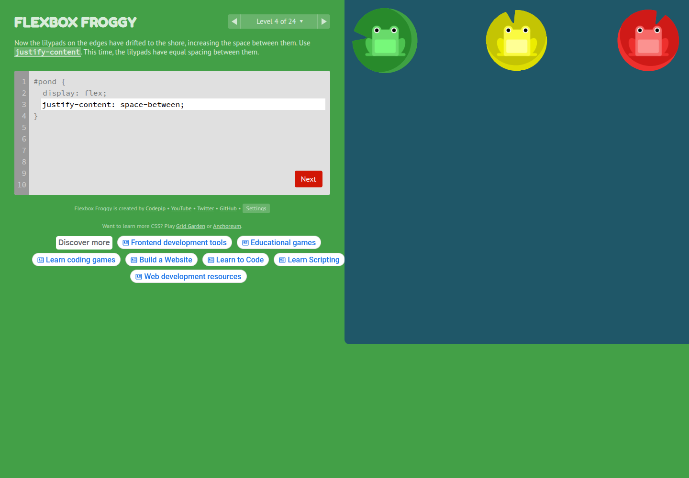

## Level 5

**Mô tả đề bài:** Đưa ba ếch xuống các lá sen nằm ở đáy ao, đồng thời giữ nguyên thứ tự và vị trí theo chiều ngang. Bài yêu cầu căn các phần tử theo chiều dọc.

**Cách làm:** Thêm `align-items: flex-end;` vào `#pond`. Khi các phần tử xếp theo hàng, trục phụ chạy từ trên xuống dưới nên `flex-end` căn cả ba ếch xuống đáy ao.

```css
#pond {
  display: flex;

  align-items: flex-end;
}
```

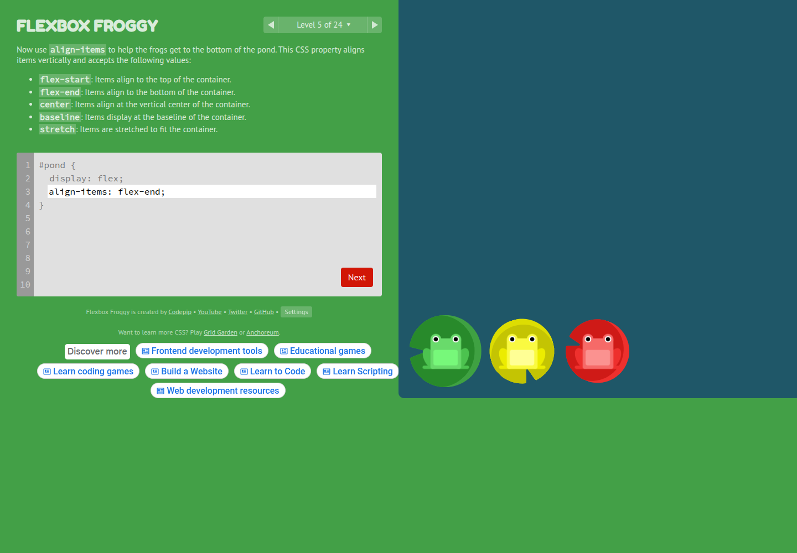

## Level 6

**Mô tả đề bài:** Đưa một ếch xanh đến lá sen nằm chính giữa ao. Cần điều chỉnh vị trí của ếch theo cả chiều ngang lẫn chiều dọc.

**Cách làm:** Kết hợp `justify-content: center;` để căn giữa theo trục ngang và `align-items: center;` để căn giữa theo trục dọc. Hai thuộc tính cùng tác động sẽ đưa ếch đến tâm ao.

```css
#pond {
  display: flex;

  justify-content: center;
  align-items: center;
}
```

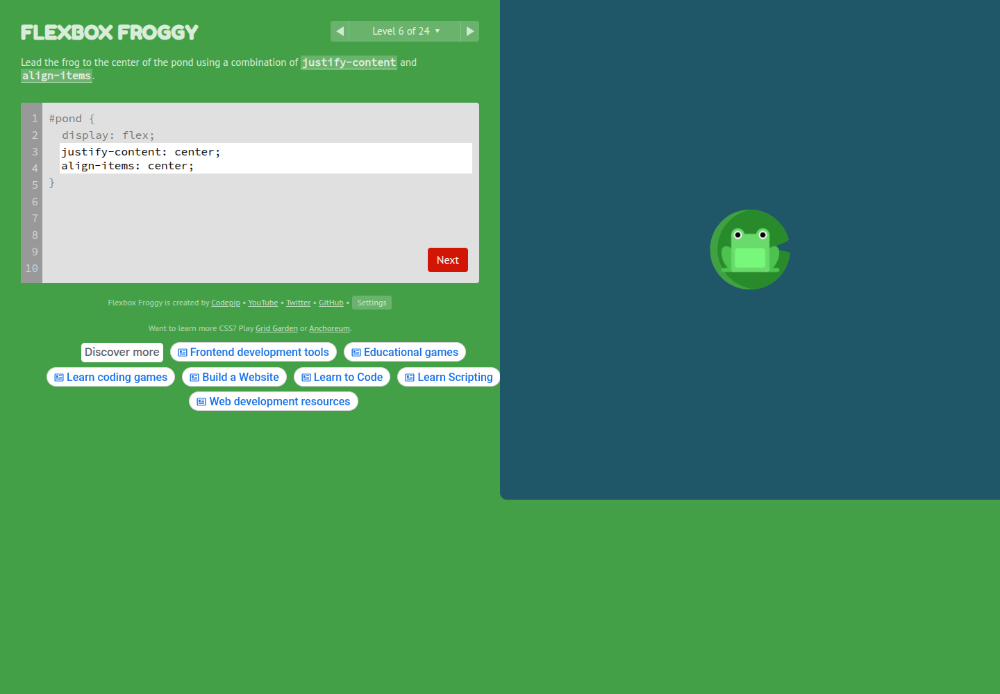

## Level 7

**Mô tả đề bài:** Đưa ba ếch đến các lá sen nằm ở đáy ao và có khoảng trống quanh từng lá. Cần vừa giãn các ếch theo chiều ngang, vừa đưa cả nhóm xuống dưới.

**Cách làm:** Dùng `justify-content: space-around;` để phân bố khoảng trống quanh từng ếch. Sau đó thêm `align-items: flex-end;` để căn cả hàng xuống đáy ao, khớp các lá sen cùng màu.

```css
#pond {
  display: flex;

  justify-content: space-around;
  align-items: flex-end;
}
```

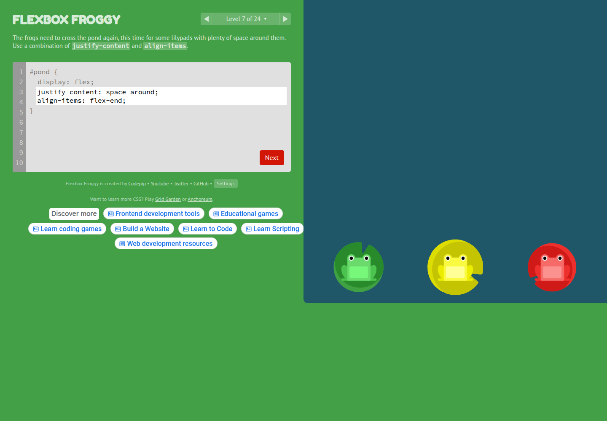

## Level 8

**Mô tả đề bài:** Các lá sen nằm ở phía trên bên phải ao với thứ tự màu ngược với hàng ếch ban đầu. Cần đổi chiều sắp xếp để từng ếch đến đúng lá sen của mình.

**Cách làm:** Đặt `flex-direction: row-reverse;` cho `#pond`. Trục chính chuyển sang hướng từ phải qua trái; ếch xanh đầu tiên nằm bên phải, tiếp theo là ếch vàng và ếch đỏ ở bên trái.

```css
#pond {
  display: flex;

  flex-direction: row-reverse;
}
```

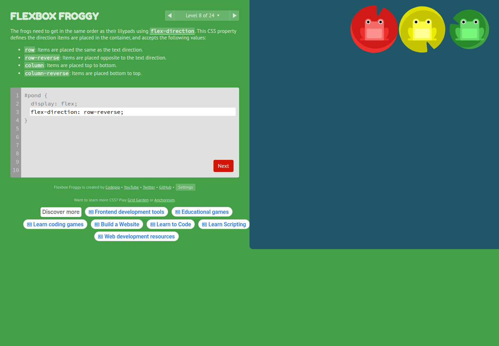

## Level 9

**Mô tả đề bài:** Đưa ba ếch đến các lá sen xếp thành một cột ở phía trái ao, theo thứ tự xanh, vàng, đỏ từ trên xuống. Hàng ếch ban đầu cần được chuyển thành cột.

**Cách làm:** Dùng `flex-direction: column;`. Trục chính chuyển từ ngang sang dọc, khiến các ếch xếp từ trên xuống dưới theo thứ tự ban đầu và khớp với cột lá sen.

```css
#pond {
  display: flex;

  flex-direction: column;
}
```

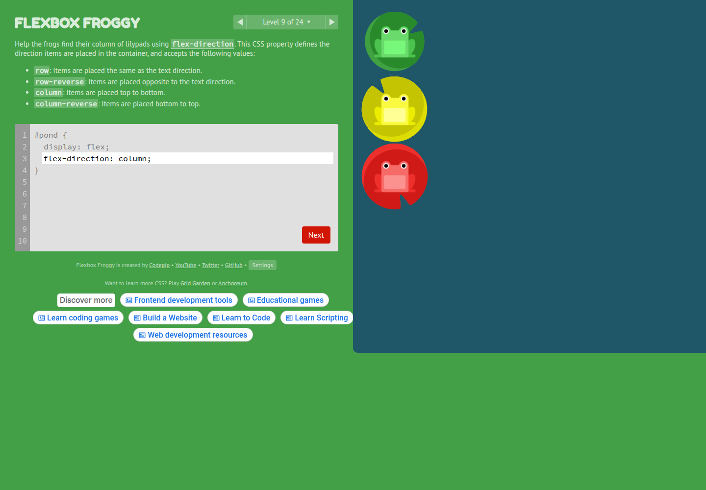

## Level 10

**Mô tả đề bài:** Đưa ba ếch đến nhóm lá sen ở phía trên bên trái ao. Thứ tự lá sen từ trái sang phải là đỏ, vàng, xanh nên cần đảo thứ tự hàng và căn nhóm về bên trái.

**Cách làm:** Dùng `flex-direction: row-reverse;` để đảo hướng hàng. Khi trục chính chạy từ phải sang trái, cuối trục nằm ở bên trái; vì vậy thêm `justify-content: flex-end;` sẽ đưa nhóm ếch về đúng phía.

```css
#pond {
  display: flex;

  flex-direction: row-reverse;
  justify-content: flex-end;
}
```

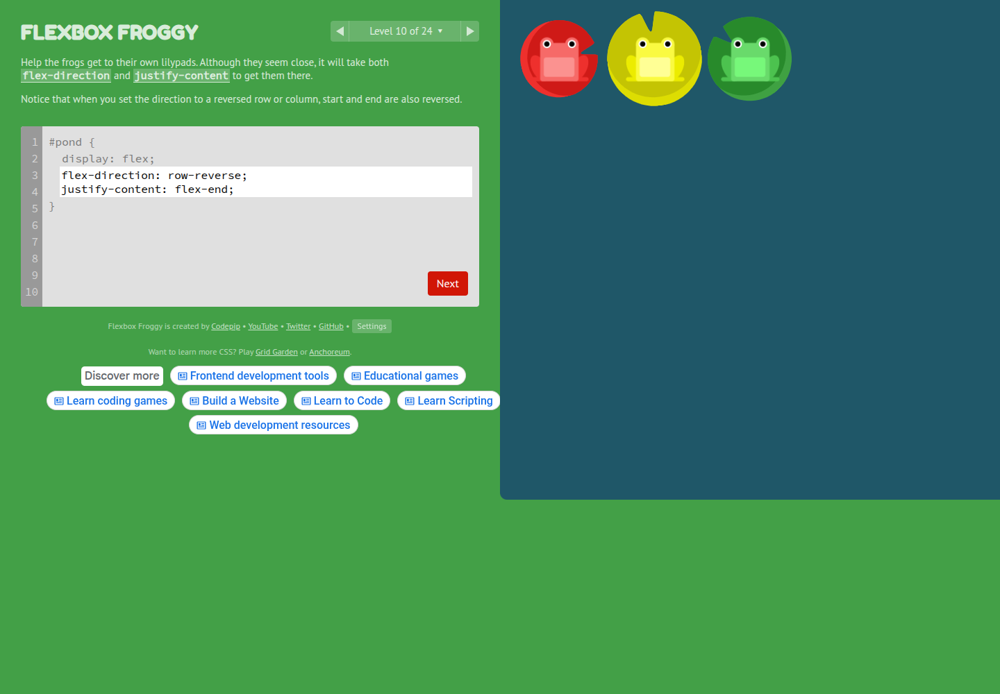

## Level 11

**Mô tả đề bài:** Đưa các ếch đến cột lá sen nằm ở phần dưới bên trái ao, theo thứ tự xanh, vàng, đỏ từ trên xuống. Cần chuyển sang bố cục cột rồi đưa cả nhóm xuống đáy.

**Cách làm:** Đặt `flex-direction: column;` để xếp ếch theo chiều dọc. Lúc này trục chính hướng xuống dưới nên `justify-content: flex-end;` căn cả cột về đáy ao.

```css
#pond {
  display: flex;

  flex-direction: column;
  justify-content: flex-end;
}
```

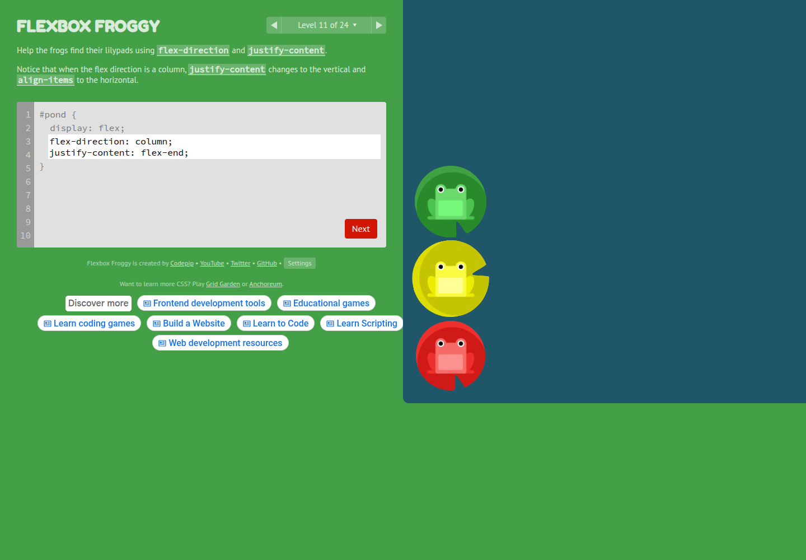

## Level 12

**Mô tả đề bài:** Ba lá sen nằm thành cột ở bên trái ao: đỏ ở trên, vàng ở giữa và xanh ở dưới. Cần đảo chiều cột và giãn các ếch theo chiều cao của ao.

**Cách làm:** Dùng `flex-direction: column-reverse;` để xếp ếch theo hướng từ dưới lên trên. Kết hợp `justify-content: space-between;` để đưa ếch đầu và cuối về hai đầu cột, còn ếch vàng nằm chính giữa.

```css
#pond {
  display: flex;

  flex-direction: column-reverse;
  justify-content: space-between;
}
```

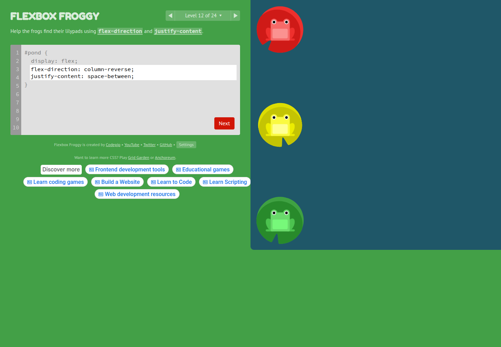

## Level 13

**Mô tả đề bài:** Đưa ba ếch đến nhóm lá sen nằm giữa đáy ao, với thứ tự đỏ, vàng, xanh từ trái sang phải. Bài yêu cầu kết hợp đổi hướng và căn chỉnh theo hai trục.

**Cách làm:** Đặt `flex-direction: row-reverse;` để đảo thứ tự hiển thị của hàng. Thêm `justify-content: center;` để đưa nhóm vào giữa theo chiều ngang và `align-items: flex-end;` để căn xuống đáy ao.

```css
#pond {
  display: flex;

  flex-direction: row-reverse;
  justify-content: center;
  align-items: flex-end;
}
```

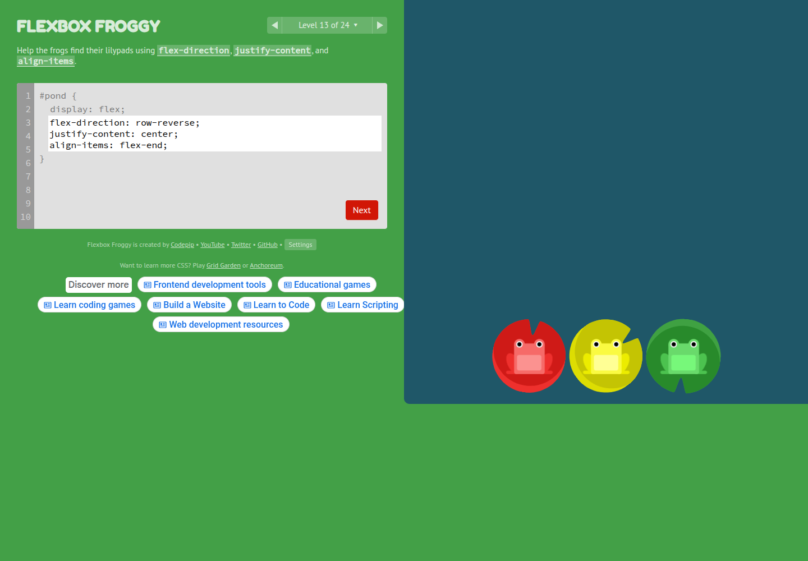

## Level 14

**Mô tả đề bài:** Các lá sen có thứ tự xanh, đỏ, vàng từ trái sang phải, trong khi ếch vàng ban đầu đứng giữa. Cần đổi thứ tự riêng ếch vàng để cả ba ếch khớp màu lá sen.

**Cách làm:** Thêm `order: 1;` vào bộ chọn `.yellow`. Các ếch còn lại có `order` mặc định là `0`, nên ếch vàng được xếp sau chúng và hàng trở thành xanh, đỏ, vàng.

```css
#pond {
  display: flex;
}

.yellow {

  order: 1;
}
```

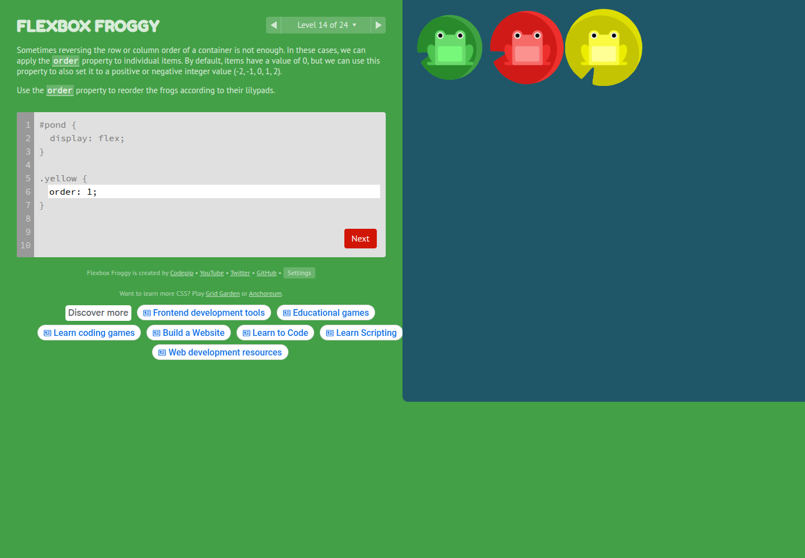

## Level 15

**Mô tả đề bài:** Đưa ếch đỏ đến lá sen đỏ ở đầu hàng bên trái, còn các ếch xanh nằm trên những lá sen phía sau. Chỉ cần thay đổi thứ tự hiển thị của ếch đỏ.

**Cách làm:** Đặt `order: -1;` cho `.red`. Giá trị này nhỏ hơn `order: 0` mặc định của các ếch xanh, nên ếch đỏ được đưa lên đầu hàng mà không làm thay đổi thứ tự tương đối của các ếch xanh.

```css
#pond {
  display: flex;
}

.red {

  order: -1;
}
```

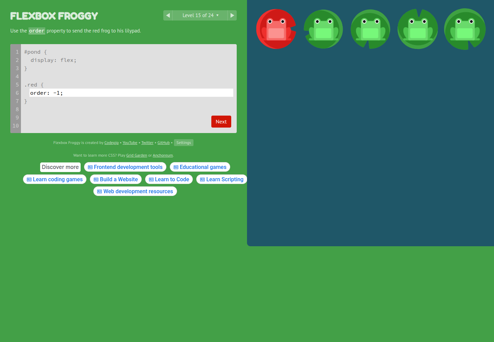

## Level 16

**Mô tả đề bài:** Các ếch xanh cần ở hàng trên, còn ếch vàng phải xuống lá sen vàng ở đáy ao, giữ nguyên vị trí ngang của nó. Bài yêu cầu căn riêng một phần tử.

**Cách làm:** Giữ `align-items: flex-start;` của `#pond` để các ếch xanh ở trên. Thêm `align-self: flex-end;` cho `.yellow` để ghi đè cách căn của riêng ếch vàng, đưa nó xuống đáy ao.

```css
#pond {
  display: flex;
  align-items: flex-start;
}

.yellow {

  align-self: flex-end;
}
```

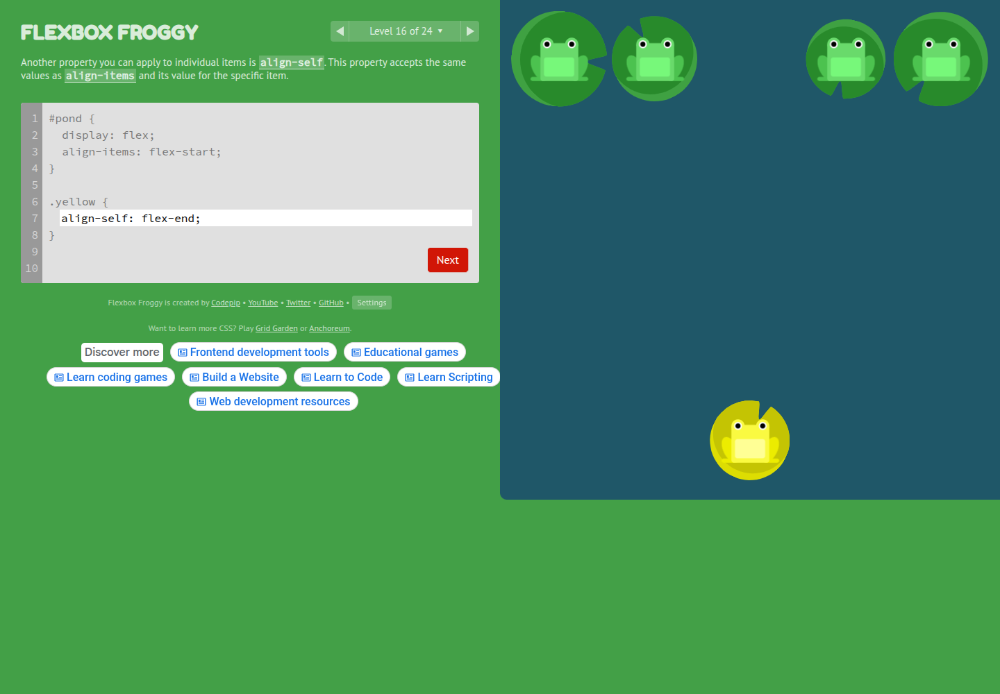

## Level 17

**Mô tả đề bài:** Đưa ba ếch xanh lên hàng trên bên trái và hai ếch vàng xuống các lá sen ở phía dưới bên phải. Các ếch vàng cần vừa đổi thứ tự trong hàng, vừa đổi vị trí theo chiều dọc.

**Cách làm:** Trong `.yellow`, dùng `order: 1;` để xếp các ếch vàng sau nhóm ếch xanh, đưa chúng sang phía phải. Kết hợp `align-self: flex-end;` để căn riêng hai ếch vàng xuống đáy, trong khi các ếch xanh vẫn ở trên.

```css
#pond {
  display: flex;
  align-items: flex-start;
}

.yellow {

  order: 1;
  align-self: flex-end;
}
```

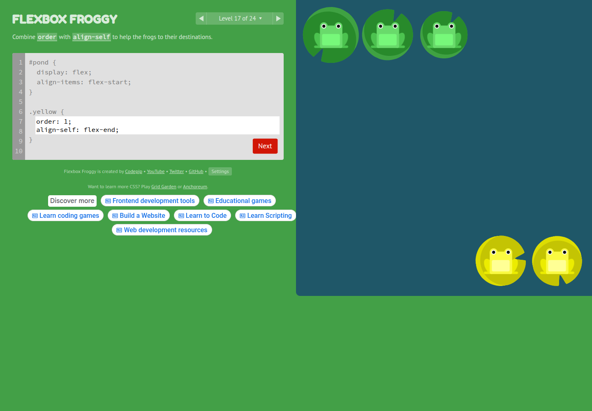

## Level 18

**Mô tả đề bài:** Số lượng ếch vượt quá sức chứa của một hàng, trong khi các lá sen được bố trí thành hai hàng. Cần cho phép các ếch chuyển xuống hàng tiếp theo để đến đúng lá sen.

**Cách làm:** Thêm `flex-wrap: wrap;` vào `#pond`. Khi hàng đầu không còn đủ chỗ, các ếch tiếp theo được chuyển xuống hàng mới; thứ tự của chúng vẫn được giữ nguyên để khớp màu lá sen.

```css
#pond {
  display: flex;

  flex-wrap: wrap;
}
```

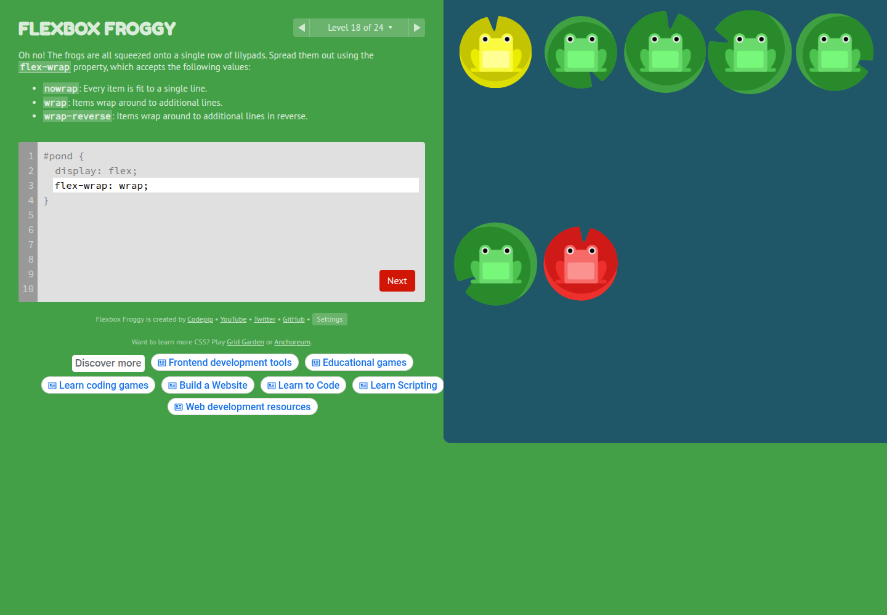

## Level 19

**Mô tả đề bài:** Đưa các ếch đến ba cột lá sen, lần lượt là xanh, đỏ và vàng từ trái sang phải. Mỗi nhóm ếch cần xếp từ trên xuống dưới và chuyển sang cột kế tiếp khi hết chỗ.

**Cách làm:** Dùng `flex-direction: column;` để chuyển trục chính sang chiều dọc. Thêm `flex-wrap: wrap;` để các ếch vượt quá chiều cao của một cột được chuyển sang cột mới bên phải.

```css
#pond {
  display: flex;

  flex-direction: column;
  flex-wrap: wrap;
}
```

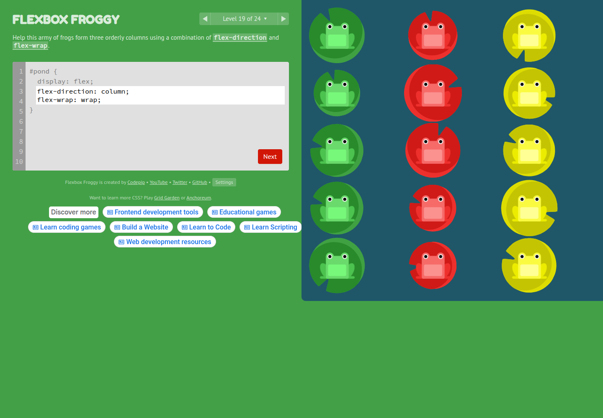

## Level 20

**Mô tả đề bài:** Sắp các ếch vào ba cột lá sen xanh, đỏ và vàng như màn trước, nhưng sử dụng thuộc tính viết gọn `flex-flow`. Cần thể hiện đồng thời hướng sắp xếp và khả năng chuyển cột.

**Cách làm:** Đặt `flex-flow: column wrap;`. Giá trị `column` tương đương `flex-direction: column`, còn `wrap` tương đương `flex-wrap: wrap`; nhờ đó ếch được xếp từ trên xuống dưới rồi chuyển sang cột tiếp theo.

```css
#pond {
  display: flex;

  flex-flow: column wrap;
}
```

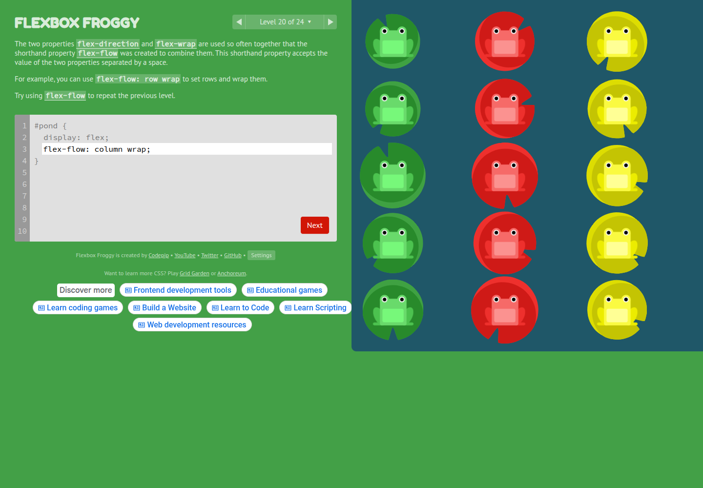

## Level 21

**Mô tả đề bài:** Các ếch đã được phép xuống dòng nhưng các lá sen nằm thành ba hàng sát nhau ở phần trên ao. Cần căn cả nhóm hàng về phía trên thay vì để các hàng trải ra theo chiều cao ao.

**Cách làm:** Giữ `flex-wrap: wrap;` và thêm `align-content: flex-start;`. Khi trục chính nằm ngang, thuộc tính này gom các hàng về đầu trục phụ, tức phía trên ao, để khớp ba hàng lá sen.

```css
#pond {
  display: flex;
  flex-wrap: wrap;

  align-content: flex-start;
}
```

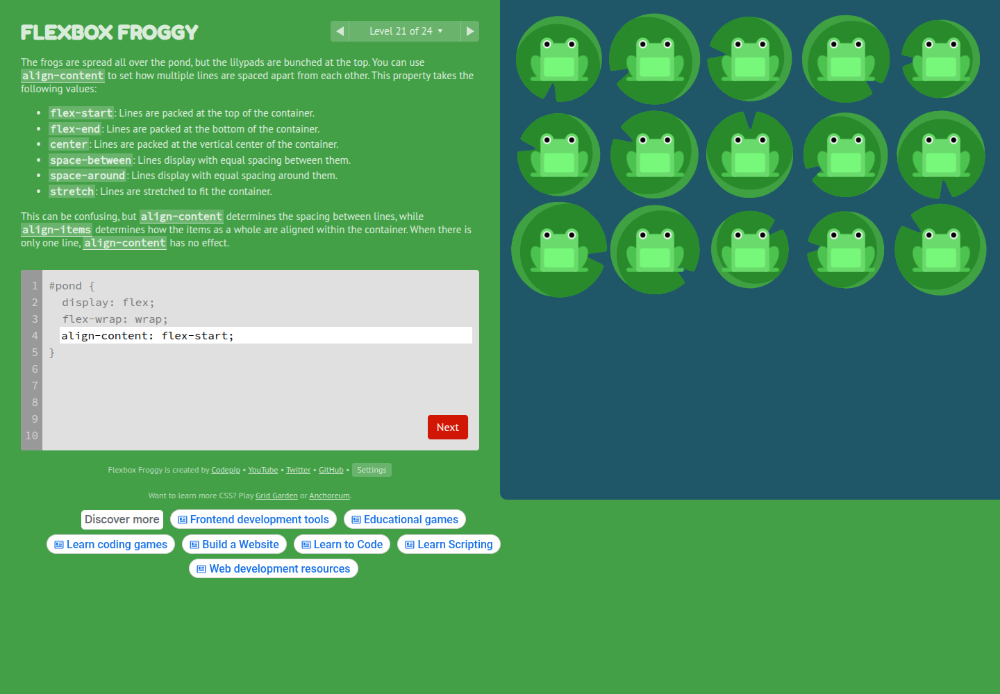

## Level 22

**Mô tả đề bài:** Các lá sen nằm thành ba hàng sát nhau ở phần dưới ao. Cần đưa toàn bộ các hàng ếch xuống dưới và giữ nguyên thứ tự các phần tử trong từng hàng.

**Cách làm:** Dùng `align-content: flex-end;` cùng với `flex-wrap: wrap;` có sẵn. Thuộc tính này căn cả nhóm hàng về cuối trục phụ, tức đáy ao, thay vì chỉ căn từng ếch trong hàng của nó.

```css
#pond {
  display: flex;
  flex-wrap: wrap;

  align-content: flex-end;
}
```

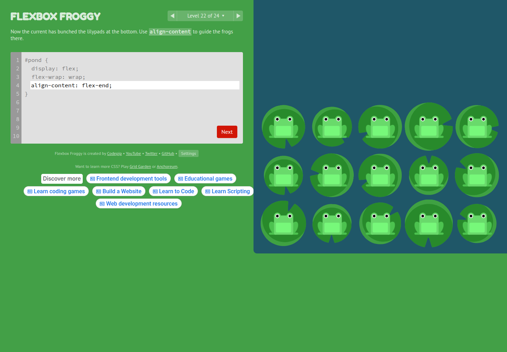

## Level 23

**Mô tả đề bài:** Các lá sen nằm thành ba cột ở giữa ao, mỗi cột có lá vàng phía trên, lá xanh ở giữa và lá đỏ phía dưới. Cần đảo chiều xếp trong cột và căn giữa cả nhóm cột.

**Cách làm:** Đặt `flex-direction: column-reverse;` để xếp ếch từ dưới lên, đồng thời giữ `flex-wrap: wrap;` để tạo nhiều cột. Khi trục chính là dọc, trục phụ nằm ngang; `align-content: center;` sẽ gom ba cột vào giữa theo chiều ngang.

```css
#pond {
  display: flex;
  flex-wrap: wrap;

  flex-direction: column-reverse;
  align-content: center;
}
```

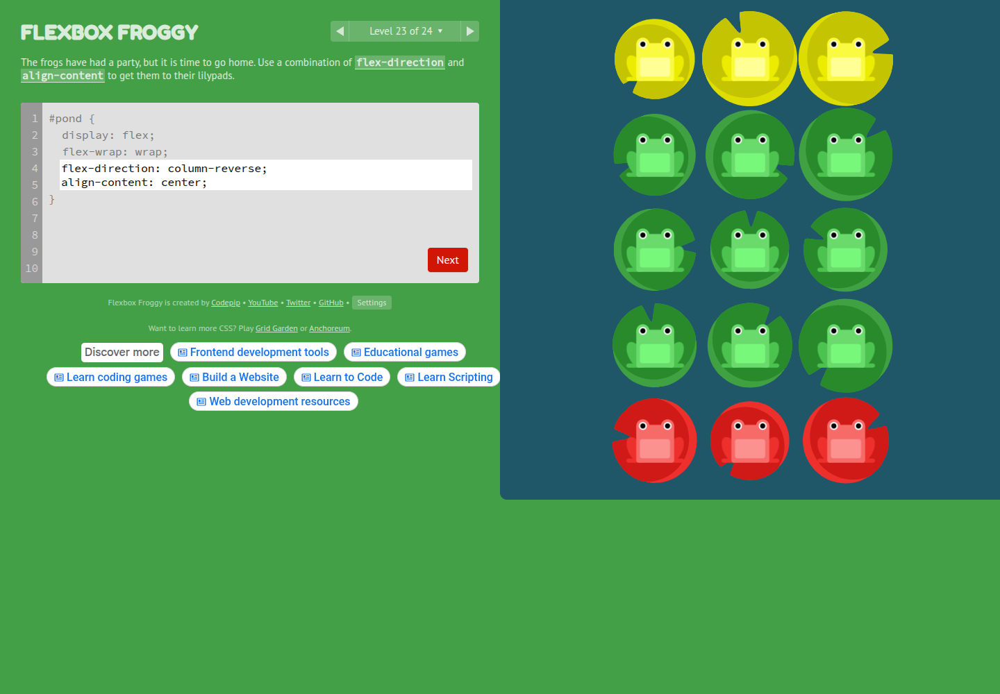

## Level 24

**Mô tả đề bài:** Đây là bài tổng hợp: các lá sen xanh và đỏ nằm trong cột sát bên phải, còn hai lá sen vàng nằm giữa chiều cao của cột sát bên trái. Cần phối hợp hướng cột, hướng chuyển cột và cách căn theo cả hai trục để đưa mọi ếch về đúng màu.

**Cách làm:** Dùng `flex-flow: column-reverse wrap-reverse;` để xếp từ dưới lên và tạo các cột mới từ phải sang trái. Thêm `justify-content: center;` để căn các ếch trong từng cột vào giữa theo chiều dọc, đặc biệt là hai ếch vàng. Cuối cùng, `align-content: space-between;` đẩy hai cột về hai mép trái và phải của ao.

```css
#pond {
  display: flex;

  flex-flow: column-reverse wrap-reverse;
  justify-content: center;
  align-content: space-between;
}
```

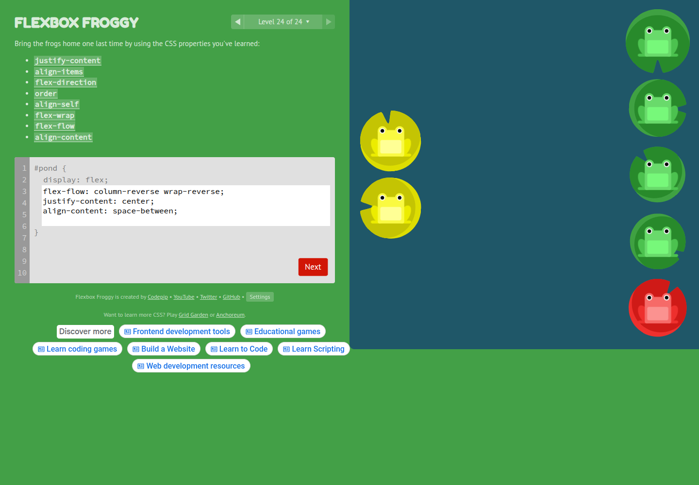

