# Nhóm 3 — Bài 2: CSS Grid Garden

- Trò chơi: [CSS Grid Garden](https://cssgridgarden.com/).
- Ngày thực hiện: 23/11/2026.
- Kết quả: hoàn thành **28/28 level** trên Google Chrome; game hiển thị **“You win!”**.
- Mỗi ảnh được chụp trực tiếp sau khi game chấp nhận lời giải và vùng nước hoặc thuốc khớp với vùng cây cần xử lý.
- Phạm vi báo cáo: bài CSS Grid Garden trong Nhóm 3.

## Kết quả hoàn thành

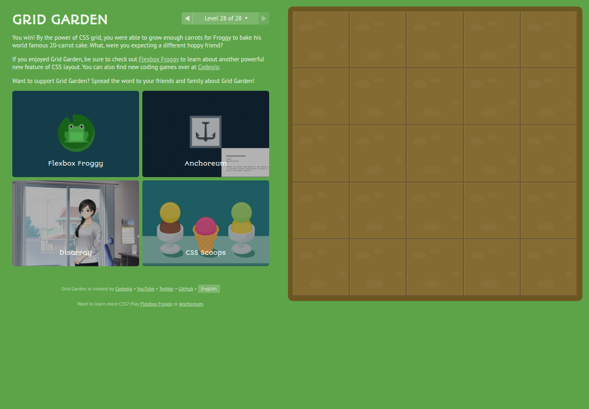

## Level 1

**Mô tả đề bài:** Đưa nước đến ô cà rốt ở cột thứ ba của hàng đầu tiên. Bài yêu cầu dùng `grid-column-start` để xác định đường lưới bắt đầu của vùng tưới.

**Cách làm:** Thêm `grid-column-start: 3;` vào `#water`. Các đường lưới dọc được đánh số từ trái sang phải, bắt đầu từ 1; đường số 3 là mép trái của cột thứ ba. Khi chỉ đặt điểm bắt đầu, vùng nước mặc định chiếm một cột.

```css
#garden {
  display: grid;
  grid-template-columns: 20% 20% 20% 20% 20%;
  grid-template-rows: 20% 20% 20% 20% 20%;
}

#water {

  grid-column-start: 3;
}
```

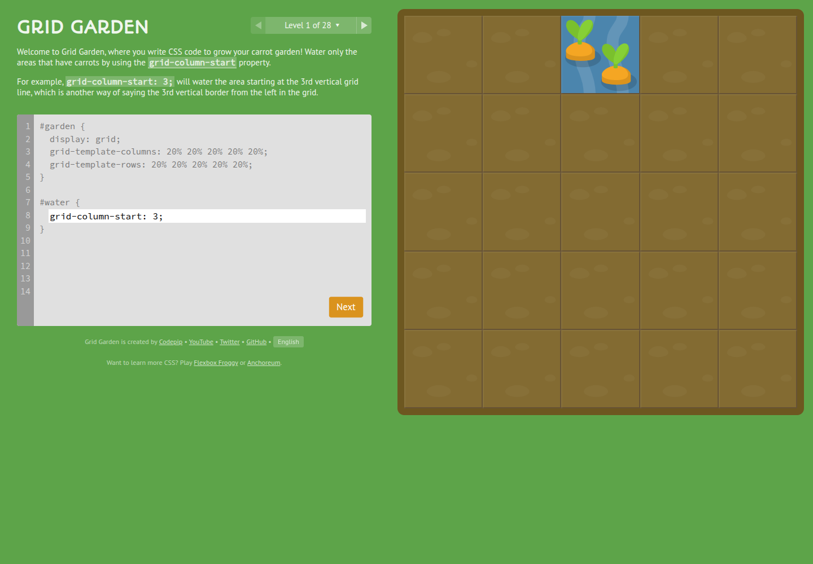

## Level 2

**Mô tả đề bài:** Đưa thuốc diệt cỏ đến ô cỏ dại ở cột cuối cùng của hàng đầu tiên. Cỏ bắt đầu tại đường lưới dọc số 5.

**Cách làm:** Đặt `grid-column-start: 5;` cho `#poison`. Vùng thuốc được chuyển đến cột thứ năm, trùng với ô cỏ dại cần xử lý.

```css
#garden {
  display: grid;
  grid-template-columns: 20% 20% 20% 20% 20%;
  grid-template-rows: 20% 20% 20% 20% 20%;
}

#poison {

  grid-column-start: 5;
}
```

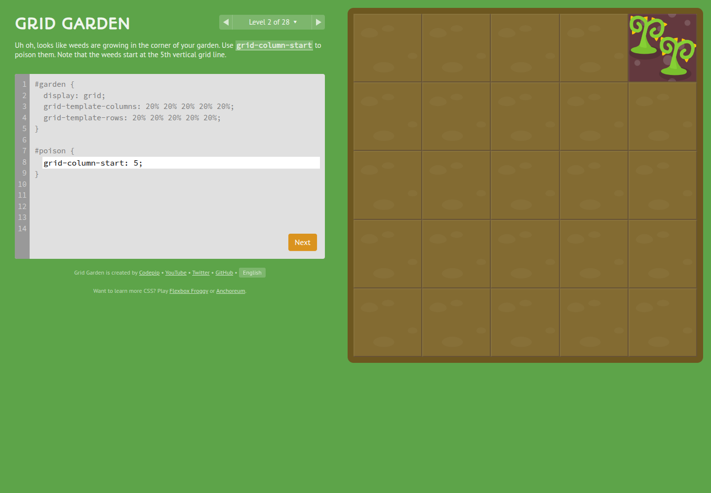

## Level 3

**Mô tả đề bài:** Tưới toàn bộ cà rốt từ đường lưới dọc số 1 đến đường số 4, đồng thời tránh tưới các ô đất còn lại. Cần mở rộng vùng nước qua nhiều cột bằng `grid-column-end`.

**Cách làm:** Giữ `grid-column-start: 1;` có sẵn và thêm `grid-column-end: 4;`. Vùng nước nằm giữa hai đường 1 và 4, nên phủ ba cột đầu tiên; số 4 là đường kết thúc, không phải cột thứ tư cần tưới.

```css
#garden {
  display: grid;
  grid-template-columns: 20% 20% 20% 20% 20%;
  grid-template-rows: 20% 20% 20% 20% 20%;
}

#water {
  grid-column-start: 1;

  grid-column-end: 4;
}
```

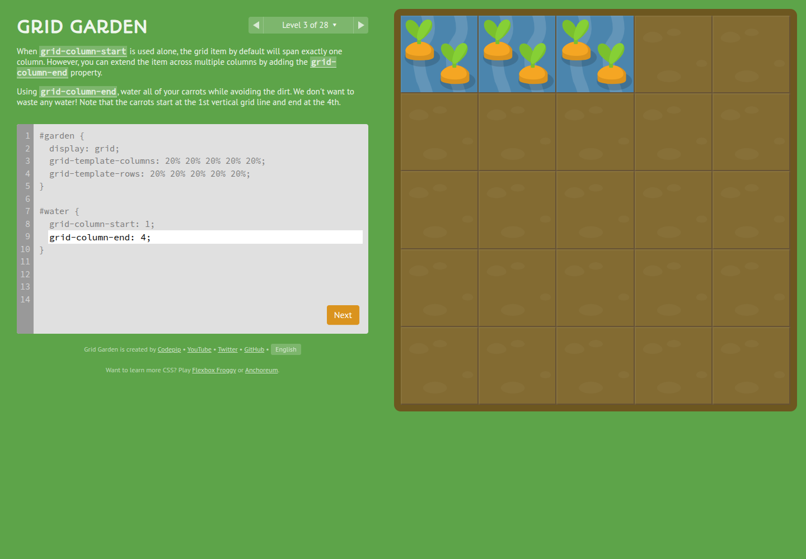

## Level 4

**Mô tả đề bài:** Tưới vùng cà rốt nằm giữa đường lưới dọc số 2 và số 5. Đề đã đặt `grid-column-start: 5;` và yêu cầu thử giá trị kết thúc nhỏ hơn giá trị bắt đầu.

**Cách làm:** Thêm `grid-column-end: 2;` vào `#water`. Khi chỉ số kết thúc nằm trước chỉ số bắt đầu, CSS Grid xử lý vùng nằm giữa hai đường đó. Kết quả là nước phủ các cột 2, 3 và 4.

```css
#garden {
  display: grid;
  grid-template-columns: 20% 20% 20% 20% 20%;
  grid-template-rows: 20% 20% 20% 20% 20%;
}

#water {
  grid-column-start: 5;

  grid-column-end: 2;
}
```

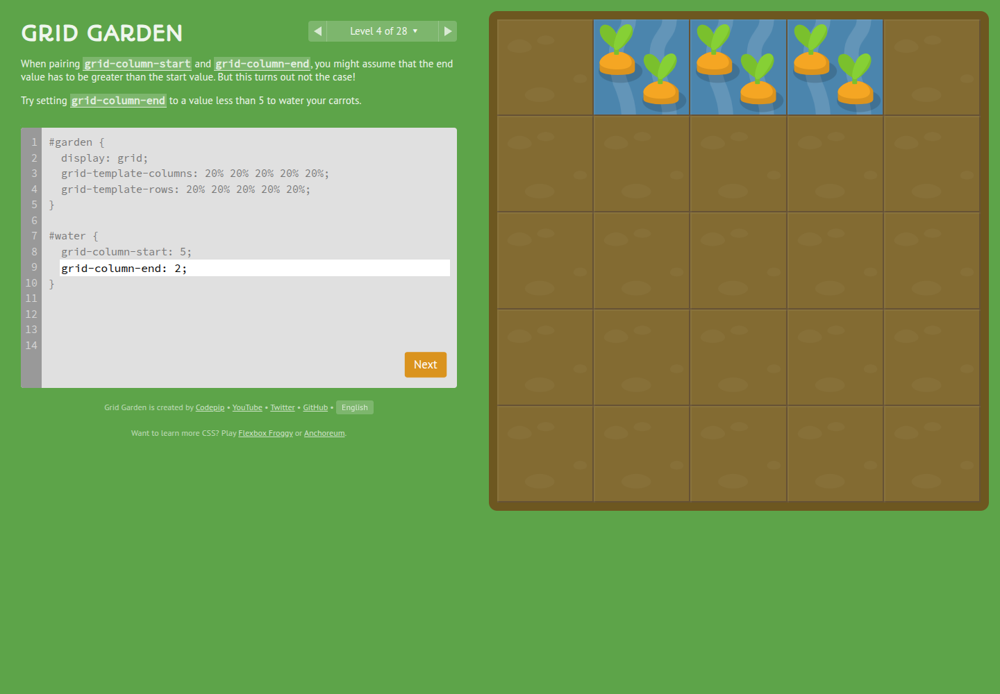

## Level 5

**Mô tả đề bài:** Tưới bốn cột cà rốt đầu tiên bằng cách dùng chỉ số âm cho đường kết thúc. Bài luyện cách đếm đường lưới từ phía bên phải.

**Cách làm:** Giữ điểm bắt đầu tại đường số 1 và đặt `grid-column-end: -2;`. Lưới có 5 cột nên có 6 đường dọc: `-1` là đường ngoài cùng bên phải, còn `-2` tương ứng đường số 5. Vùng nước vì vậy phủ cột 1 đến cột 4.

```css
#garden {
  display: grid;
  grid-template-columns: 20% 20% 20% 20% 20%;
  grid-template-rows: 20% 20% 20% 20% 20%;
}

#water {
  grid-column-start: 1;

  grid-column-end: -2;
}
```

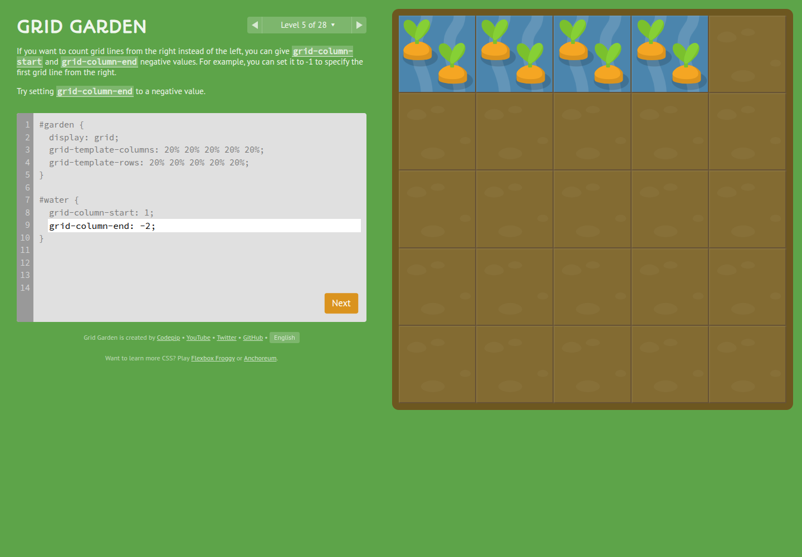

## Level 6

**Mô tả đề bài:** Đưa thuốc đến ô cỏ dại ở cột thứ tư bằng chỉ số âm của `grid-column-start`. Cần xác định vị trí từ phía bên phải lưới.

**Cách làm:** Đặt `grid-column-start: -3;` cho `#poison`. Với 6 đường dọc, đường thứ ba tính từ phải sang là đường số 4 tính từ trái sang; vùng thuốc chiếm một ô bắt đầu tại đường này.

```css
#garden {
  display: grid;
  grid-template-columns: 20% 20% 20% 20% 20%;
  grid-template-rows: 20% 20% 20% 20% 20%;
}

#poison {

  grid-column-start: -3;
}
```

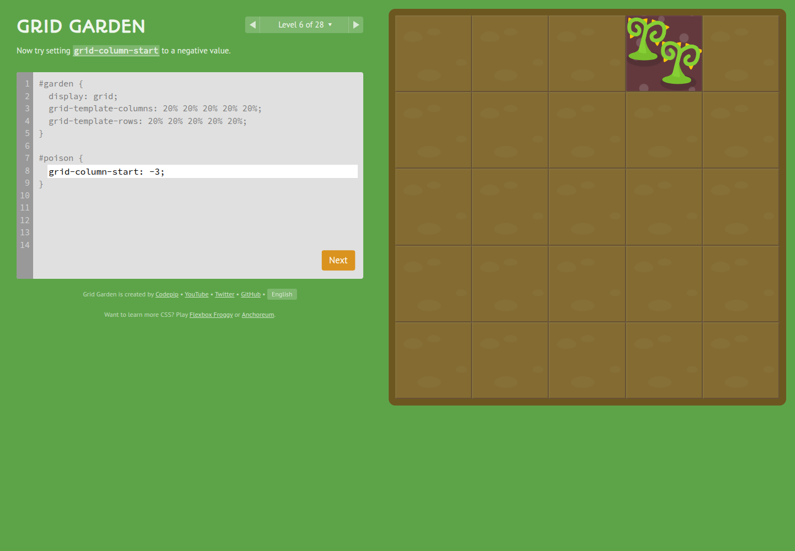

## Level 7

**Mô tả đề bài:** Tưới hai cột cà rốt liên tiếp, bắt đầu từ đường lưới dọc số 2. Bài yêu cầu dùng từ khóa `span` để chỉ số cột mà vùng nước chiếm.

**Cách làm:** Giữ `grid-column-start: 2;` và thêm `grid-column-end: span 2;`. `span 2` cho vùng nước trải qua hai cột kể từ điểm bắt đầu, tức cột 2 và cột 3.

```css
#garden {
  display: grid;
  grid-template-columns: 20% 20% 20% 20% 20%;
  grid-template-rows: 20% 20% 20% 20% 20%;
}

#water {
  grid-column-start: 2;

  grid-column-end: span 2;
}
```

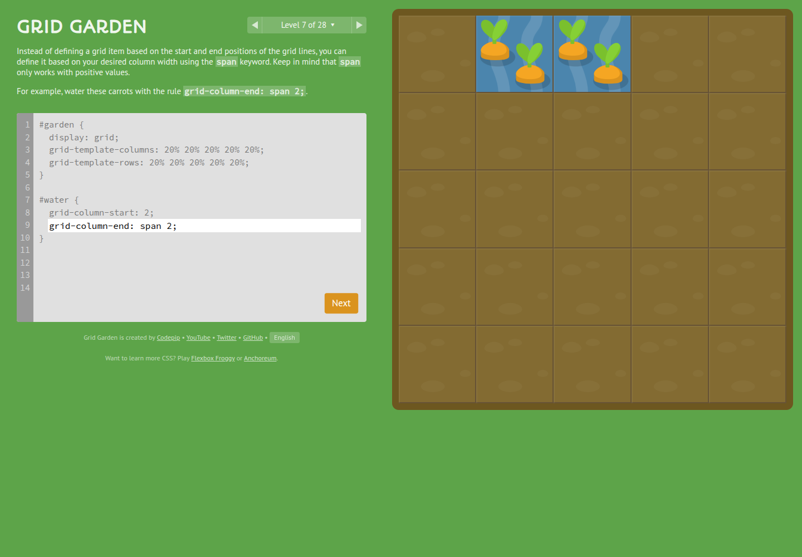

## Level 8

**Mô tả đề bài:** Tưới toàn bộ năm cột cà rốt của hàng đầu tiên. Điểm bắt đầu đã được đặt tại đường số 1; cần mở rộng vùng nước bằng `span`.

**Cách làm:** Đặt `grid-column-end: span 5;`. Vùng nước bắt đầu ở đường số 1 và chiếm liên tiếp 5 cột, nên kết thúc tại đường số 6 và phủ hết hàng cà rốt.

```css
#garden {
  display: grid;
  grid-template-columns: 20% 20% 20% 20% 20%;
  grid-template-rows: 20% 20% 20% 20% 20%;
}

#water {
  grid-column-start: 1;

  grid-column-end: span 5;
}
```

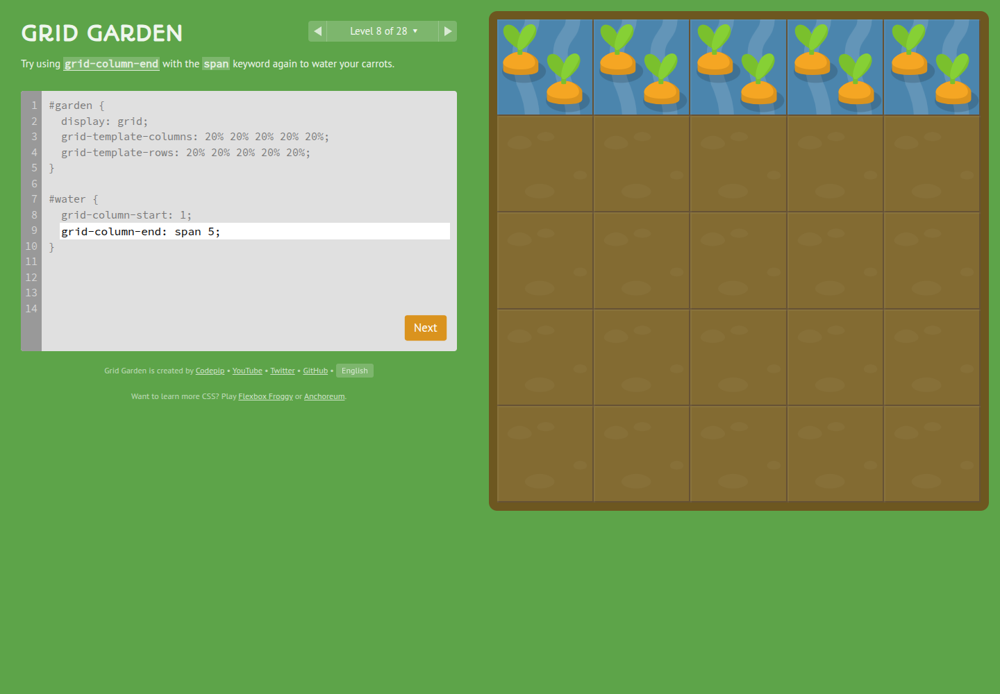

## Level 9

**Mô tả đề bài:** Tưới ba cột cà rốt cuối cùng, với đường kết thúc đã cố định ở số 6. Cần dùng `span` trong `grid-column-start` để tính ngược từ điểm kết thúc.

**Cách làm:** Thêm `grid-column-start: span 3;` vào `#water`. Vì vùng nước phải chiếm 3 cột và kết thúc ở đường số 6, điểm bắt đầu được xác định ở đường số 3; nước phủ các cột 3, 4 và 5.

```css
#garden {
  display: grid;
  grid-template-columns: 20% 20% 20% 20% 20%;
  grid-template-rows: 20% 20% 20% 20% 20%;
}

#water {

  grid-column-start: span 3;
  grid-column-end: 6;
}
```

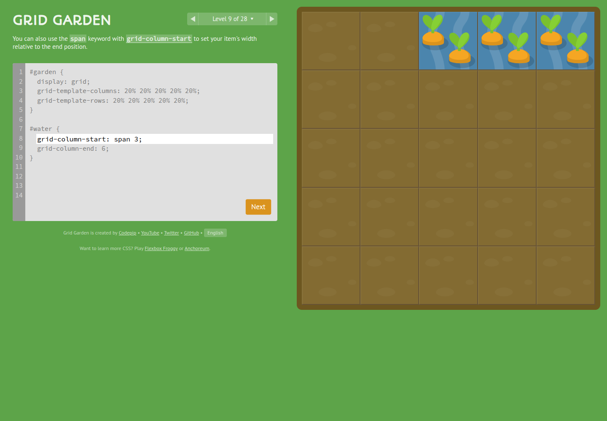

## Level 10

**Mô tả đề bài:** Tưới hai cột cà rốt ở phía bên phải của hàng đầu tiên. Bài yêu cầu dùng thuộc tính viết gọn `grid-column` thay cho việc khai báo riêng đường bắt đầu và đường kết thúc.

**Cách làm:** Dùng `grid-column: 4 / 6;`. Giá trị trước dấu `/` là đường bắt đầu, giá trị sau là đường kết thúc; nước vì vậy phủ cột 4 và cột 5.

```css
#garden {
  display: grid;
  grid-template-columns: 20% 20% 20% 20% 20%;
  grid-template-rows: 20% 20% 20% 20% 20%;
}

#water {

  grid-column: 4 / 6;
}
```

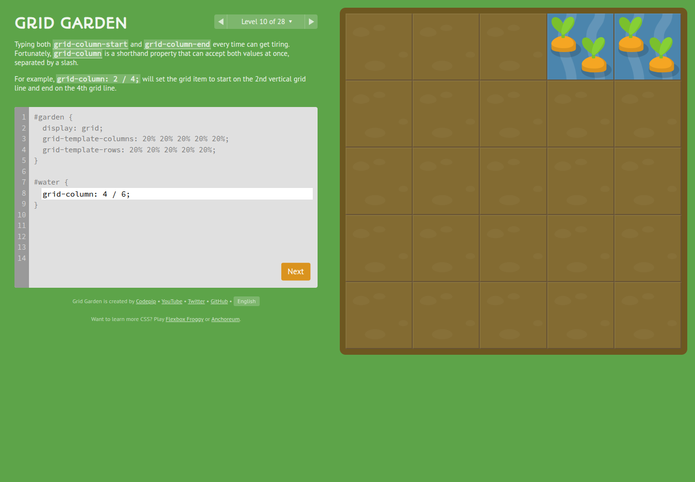

## Level 11

**Mô tả đề bài:** Tưới một vùng cà rốt rộng ba cột, bắt đầu từ đường lưới dọc số 2. Cần kết hợp thuộc tính viết gọn `grid-column` với từ khóa `span`.

**Cách làm:** Đặt `grid-column: 2 / span 3;`. Vùng nước bắt đầu ở đường số 2 và trải qua 3 cột, tương đương kết thúc ở đường số 5, nên phủ cột 2 đến cột 4.

```css
#garden {
  display: grid;
  grid-template-columns: 20% 20% 20% 20% 20%;
  grid-template-rows: 20% 20% 20% 20% 20%;
}

#water {

  grid-column: 2 / span 3;
}
```

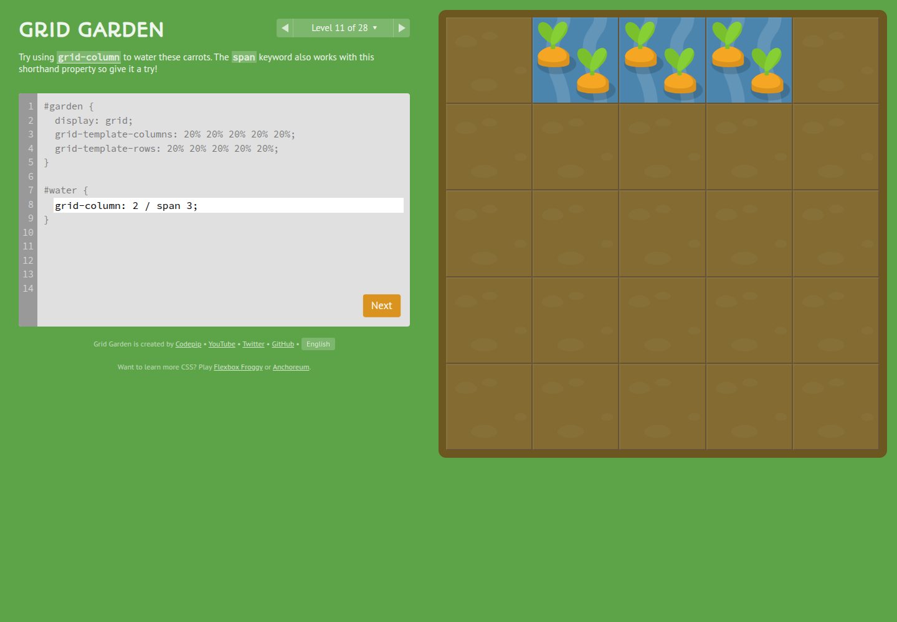

## Level 12

**Mô tả đề bài:** Đưa nước xuống ô cà rốt ở hàng thứ ba của cột đầu tiên. Bài giới thiệu cách định vị phần tử theo chiều dọc bằng `grid-row-start`.

**Cách làm:** Thêm `grid-row-start: 3;` cho `#water`. Các đường lưới ngang được đếm từ trên xuống, bắt đầu từ 1; đường số 3 là mép trên của hàng thứ ba.

```css
#garden {
  display: grid;
  grid-template-columns: 20% 20% 20% 20% 20%;
  grid-template-rows: 20% 20% 20% 20% 20%;
}

#water {

  grid-row-start: 3;
}
```

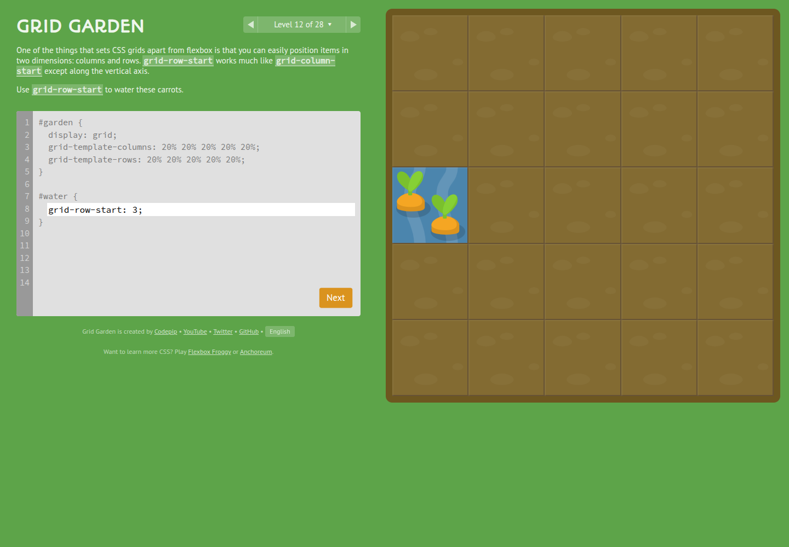

## Level 13

**Mô tả đề bài:** Tưới vùng cà rốt kéo dài qua ba hàng cuối của cột đầu tiên. Cần dùng `grid-row` để chỉ định đồng thời đường bắt đầu và đường kết thúc theo chiều dọc.

**Cách làm:** Dùng `grid-row: 3 / 6;`. Nước trải từ đường ngang số 3 đến đường số 6, tương ứng các hàng 3, 4 và 5.

```css
#garden {
  display: grid;
  grid-template-columns: 20% 20% 20% 20% 20%;
  grid-template-rows: 20% 20% 20% 20% 20%;
}

#water {

  grid-row: 3 / 6;
}
```

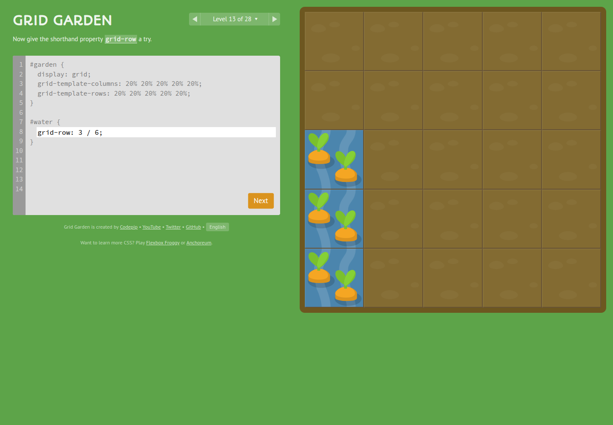

## Level 14

**Mô tả đề bài:** Đưa thuốc đến ô cỏ dại ở cột thứ hai, hàng thứ năm. Bài yêu cầu xác định vị trí đồng thời theo cả chiều ngang và chiều dọc.

**Cách làm:** Trong `#poison`, đặt `grid-column: 2;` để chọn cột thứ hai và `grid-row: 5;` để chọn hàng cuối cùng. Hai thuộc tính cùng xác định đúng ô cần diệt cỏ.

```css
#garden {
  display: grid;
  grid-template-columns: 20% 20% 20% 20% 20%;
  grid-template-rows: 20% 20% 20% 20% 20%;
}

#poison {

  grid-column: 2;
  grid-row: 5;
}
```

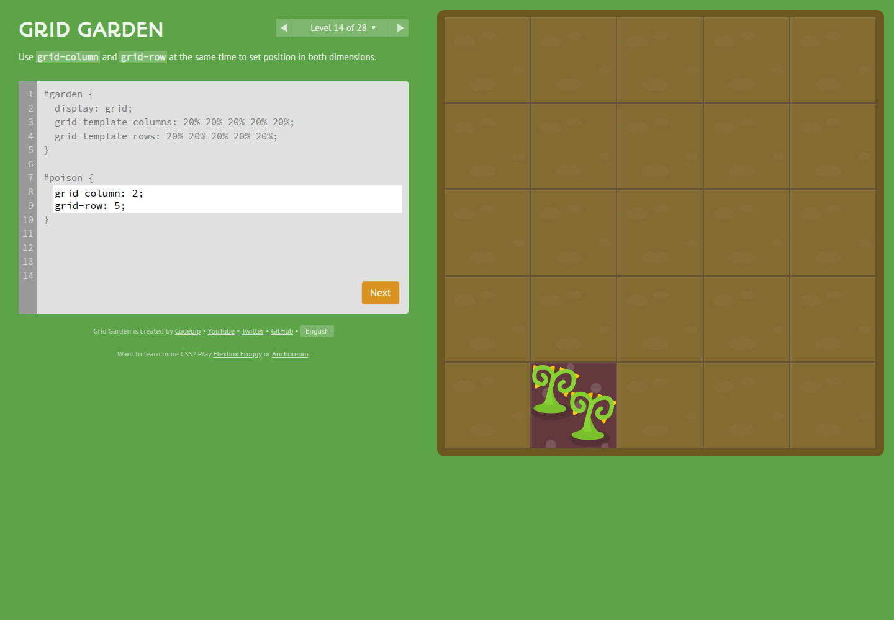

## Level 15

**Mô tả đề bài:** Tưới vùng cà rốt hình chữ nhật phủ các cột 2 đến 5 và toàn bộ năm hàng, đồng thời chừa cột đất đầu tiên. Cần gộp nhiều ô theo cả hai chiều.

**Cách làm:** Đặt `grid-column: 2 / 6;` để phủ bốn cột bên phải. Thêm `grid-row: 1 / 6;` để phủ đủ năm hàng. Giao của hai khoảng tạo thành vùng tưới hình chữ nhật đúng yêu cầu.

```css
#garden {
  display: grid;
  grid-template-columns: 20% 20% 20% 20% 20%;
  grid-template-rows: 20% 20% 20% 20% 20%;
}

#water {

  grid-column: 2 / 6;
  grid-row: 1 / 6;
}
```

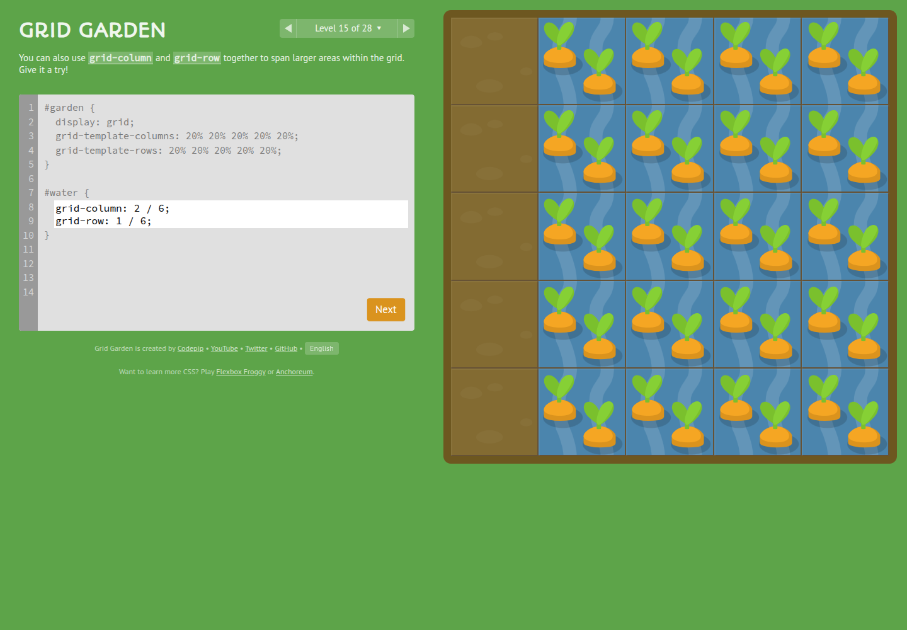

## Level 16

**Mô tả đề bài:** Tưới vùng cà rốt nằm trên các hàng 1 đến 3 và các cột 2 đến 5. Bài yêu cầu dùng `grid-area` để mô tả toàn bộ vùng bằng một thuộc tính.

**Cách làm:** Dùng `grid-area: 1 / 2 / 4 / 6;`. Bốn giá trị lần lượt là đường bắt đầu hàng, bắt đầu cột, kết thúc hàng và kết thúc cột. Vùng nước được giới hạn giữa đường hàng 1–4 và đường cột 2–6.

```css
#garden {
  display: grid;
  grid-template-columns: 20% 20% 20% 20% 20%;
  grid-template-rows: 20% 20% 20% 20% 20%;
}

#water {

  grid-area: 1 / 2 / 4 / 6;
}
```

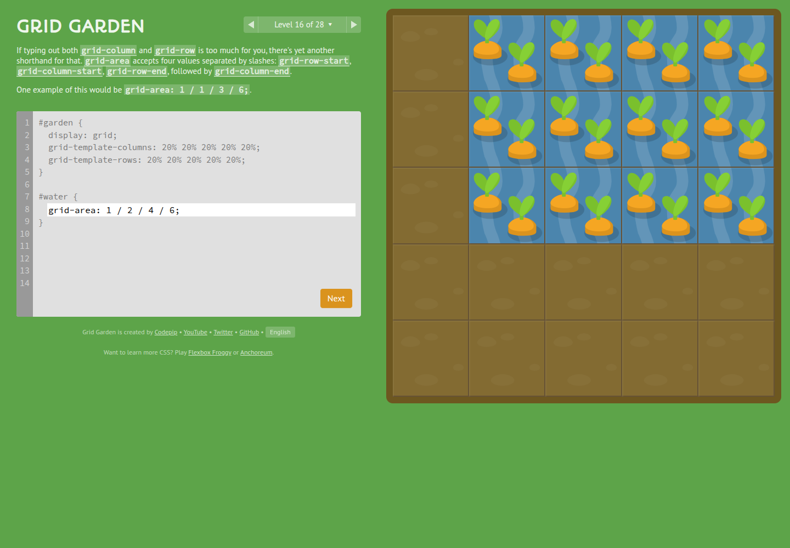

## Level 17

**Mô tả đề bài:** Một vùng nước đã tưới cột thứ tư; cần thêm vùng nước thứ hai để phủ các cà rốt còn lại ở hàng 2 đến 4, cột 3 đến 5. Hai vùng nước được phép chồng lên nhau.

**Cách làm:** Giữ nguyên `#water-1` và đặt `grid-area: 2 / 3 / 5 / 6;` cho `#water-2`. Vùng mới phủ ba hàng và ba cột ở giữa, giao với vùng nước thứ nhất tại cột 4 và bảo đảm mọi cà rốt đều được tưới.

```css
#garden {
  display: grid;
  grid-template-columns: 20% 20% 20% 20% 20%;
  grid-template-rows: 20% 20% 20% 20% 20%;
}

#water-1 {
  grid-area: 1 / 4 / 6 / 5;
}

#water-2 {

  grid-area: 2 / 3 / 5 / 6;
}
```

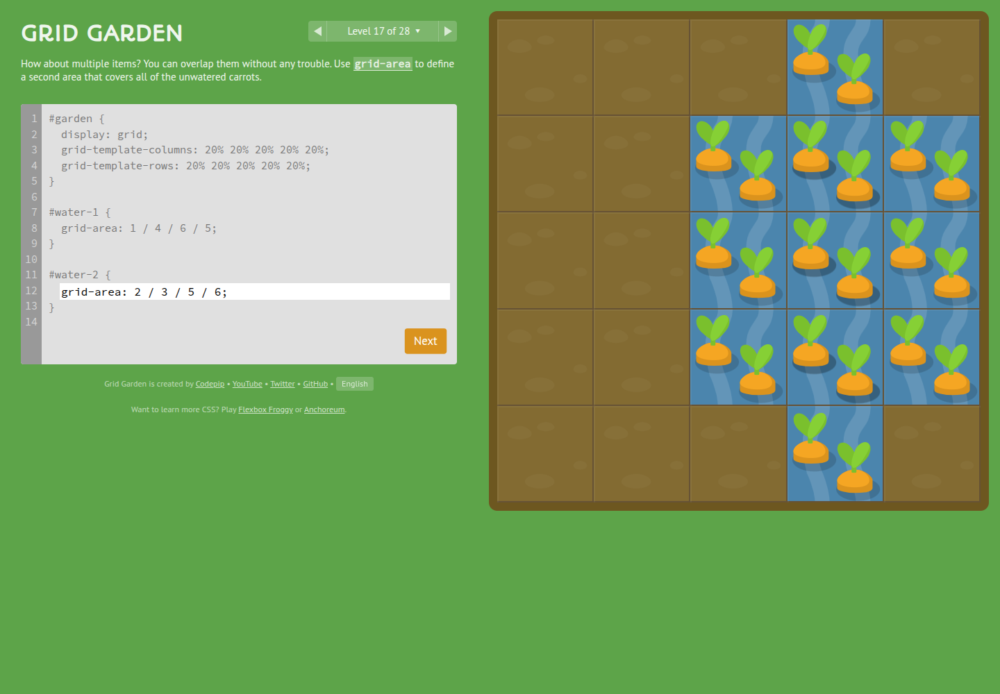

## Level 18

**Mô tả đề bài:** Nước và thuốc đang bị đặt sai: vùng thuốc nằm trên cà rốt, trong khi cỏ dại ở cột cuối lại nhận nước. Cần đổi thứ tự tự động bố trí của vùng thuốc.

**Cách làm:** Thêm `order: 1;` cho `#poison`, trong khi các vùng `.water` giữ `order: 0;`. CSS Grid xếp phần tử có `order` nhỏ trước, nên thuốc được đưa sau các vùng nước và đến cột cỏ dại cuối cùng.

```css
#garden {
  display: grid;
  grid-template-columns: 20% 20% 20% 20% 20%;
  grid-template-rows: 20% 20% 20% 20% 20%;
}

.water {
  order: 0;
}

#poison {

  order: 1;
}
```

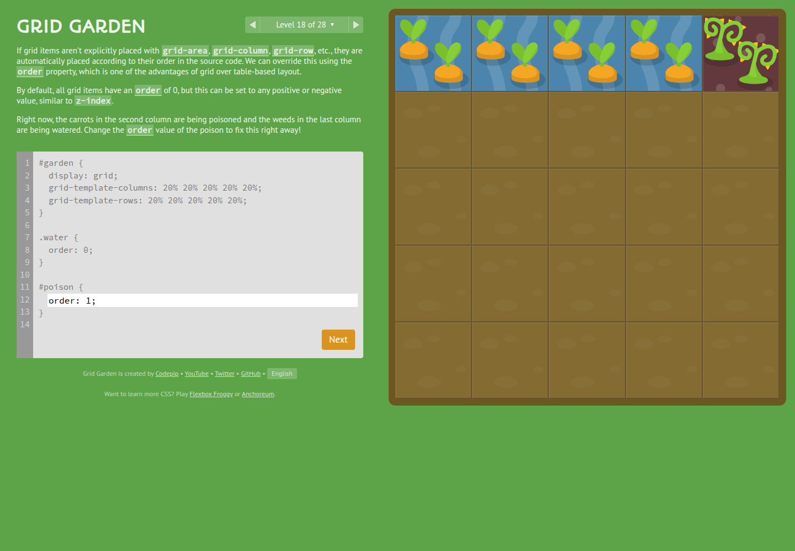

## Level 19

**Mô tả đề bài:** Các vùng nước và thuốc đang xen kẽ, nhưng cỏ dại đều tập trung ở đầu khu vườn. Cần đưa toàn bộ vùng thuốc lên trước các vùng nước.

**Cách làm:** Đặt `order: -1;` cho `.poison`. Giá trị này nhỏ hơn `order: 0;` của `.water`, nên các vùng thuốc được tự động bố trí trước để phủ nhóm cỏ dại, sau đó mới đến các vùng tưới cà rốt.

```css
#garden {
  display: grid;
  grid-template-columns: 20% 20% 20% 20% 20%;
  grid-template-rows: 20% 20% 20% 20% 20%;
}

.water {
  order: 0;
}

.poison {

  order: -1;
}
```

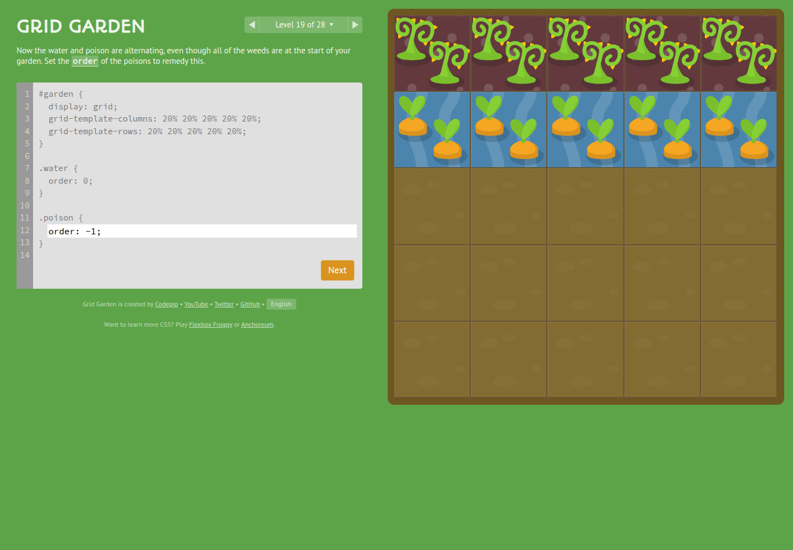

## Level 20

**Mô tả đề bài:** Vùng cà rốt ở hàng đầu tiên rộng bằng 50% chiều ngang khu vườn. Bài yêu cầu thay đổi kích thước cột bằng `grid-template-columns` thay vì di chuyển vùng nước.

**Cách làm:** Đặt `grid-template-columns: 50%;` cho `#garden`. Cột đầu tiên có chiều rộng bằng một nửa khu vườn; vùng `#water` đang ở cột 1, hàng 1 vì vậy tự mở rộng đúng bằng vùng cà rốt.

```css
#garden {
  display: grid;

  grid-template-columns: 50%;
  grid-template-rows: 20% 20% 20% 20% 20%;
}

#water {
  grid-column: 1;
  grid-row: 1;
}
```

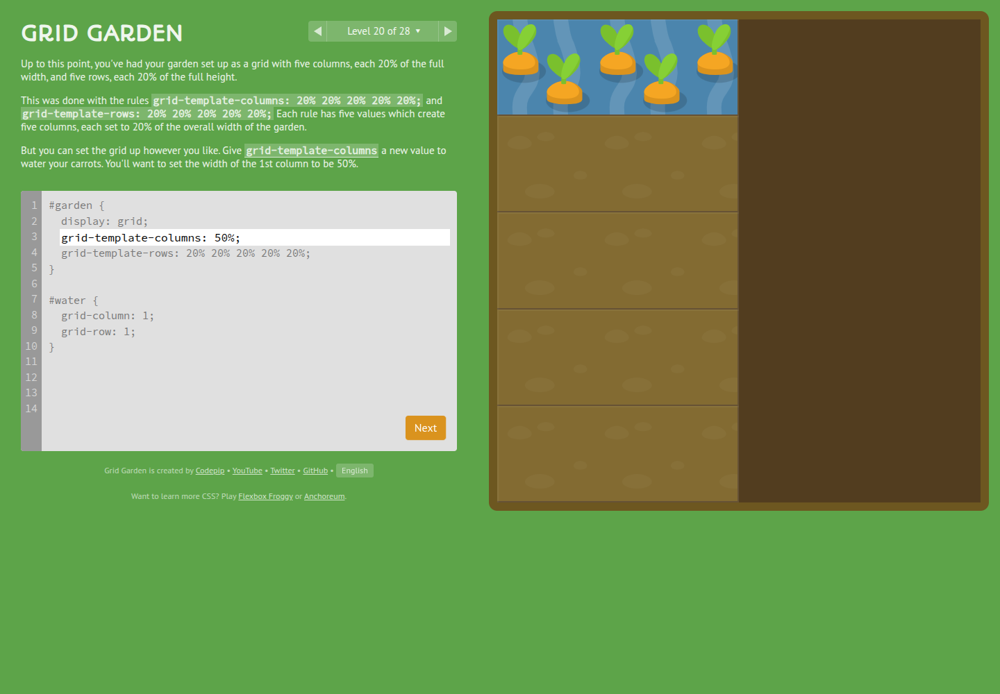

## Level 21

**Mô tả đề bài:** Tạo tám cột bằng nhau, mỗi cột rộng 12,5% khu vườn, để vùng nước ở cột đầu không tưới quá rộng. Đề yêu cầu dùng hàm `repeat()`.

**Cách làm:** Dùng `grid-template-columns: repeat(8, 12.5%);`. Hàm này lặp lại kích thước `12.5%` tám lần, tạo đủ tám cột với tổng chiều rộng 100% mà không phải viết tám giá trị riêng.

```css
#garden {
  display: grid;

  grid-template-columns: repeat(8, 12.5%);
  grid-template-rows: 20% 20% 20% 20% 20%;
}

#water {
  grid-column: 1;
  grid-row: 1;
}
```

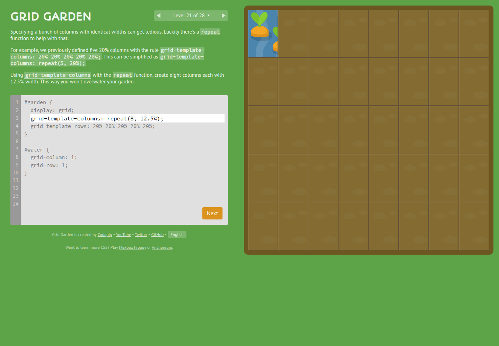

## Level 22

**Mô tả đề bài:** Tạo ba cột có chiều rộng lần lượt là `100px`, `3em` và `40%`. Bài luyện cách kết hợp các đơn vị kích thước khác nhau trong cùng một lưới.

**Cách làm:** Đặt `grid-template-columns: 100px 3em 40%;`. Ba giá trị tương ứng ba cột theo thứ tự trái sang phải: cột đầu cố định theo pixel, cột thứ hai phụ thuộc cỡ chữ của phần tử lưới và cột thứ ba chiếm 40% chiều rộng khu vườn.

```css
#garden {
  display: grid;

  grid-template-columns: 100px 3em 40%;
  grid-template-rows: 20% 20% 20% 20% 20%;
}
```

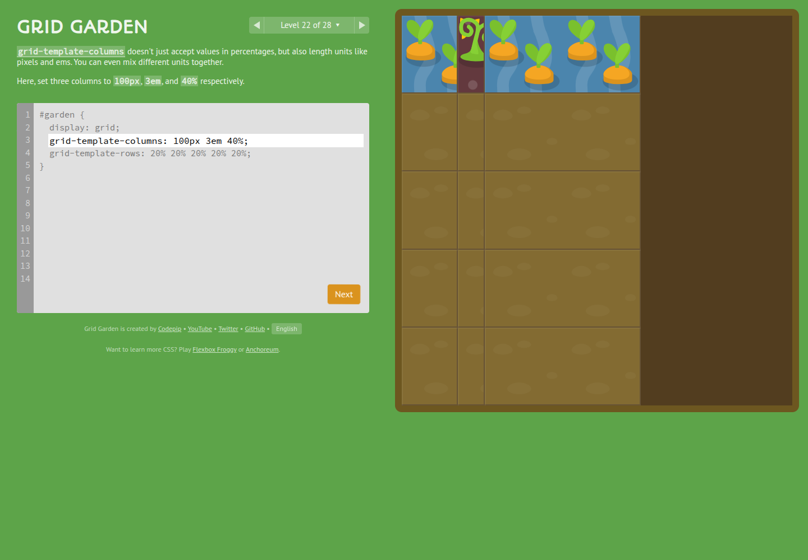

## Level 23

**Mô tả đề bài:** Ở hàng đầu tiên, cỏ dại chiếm 1/6 chiều rộng bên trái, còn cà rốt chiếm 5/6 còn lại. Cần tạo hai cột theo đúng tỉ lệ này bằng đơn vị `fr`.

**Cách làm:** Dùng `grid-template-columns: 1fr 5fr;`. Phần chiều rộng khả dụng được chia thành 6 phần bằng nhau; cột đầu nhận 1 phần để diệt cỏ, cột sau nhận 5 phần để tưới cà rốt.

```css
#garden {
  display: grid;

  grid-template-columns: 1fr 5fr;
  grid-template-rows: 20% 20% 20% 20% 20%;
}
```

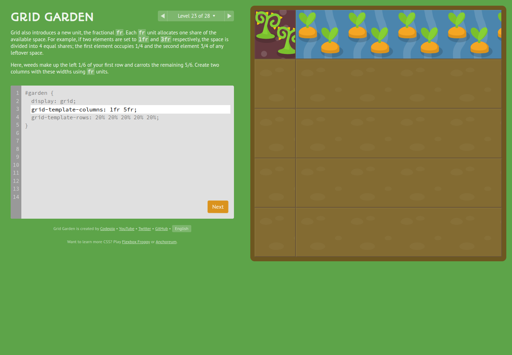

## Level 24

**Mô tả đề bài:** Cà rốt tạo thành một cột rộng 50px ở mép trái, cỏ dại tạo thành một cột rộng 50px ở mép phải. Cần tạo thêm ba cột ở giữa để chia hết phần chiều rộng còn lại.

**Cách làm:** Dùng `grid-template-columns: 50px repeat(3, 1fr) 50px;`. Hai cột ngoài cùng giữ chiều rộng 50px; sau khi trừ chúng, phần còn lại được chia đều cho ba cột giữa. Các vùng nước và thuốc có sẵn sẽ khớp với hai cột ở mép.

```css
#garden {
  display: grid;

  grid-template-columns: 50px repeat(3, 1fr) 50px;
  grid-template-rows: 20% 20% 20% 20% 20%;
}

#water {
  grid-area: 1 / 1 / 6 / 2;
}

#poison {
  grid-area: 1 / 5 / 6 / 6;
}
```

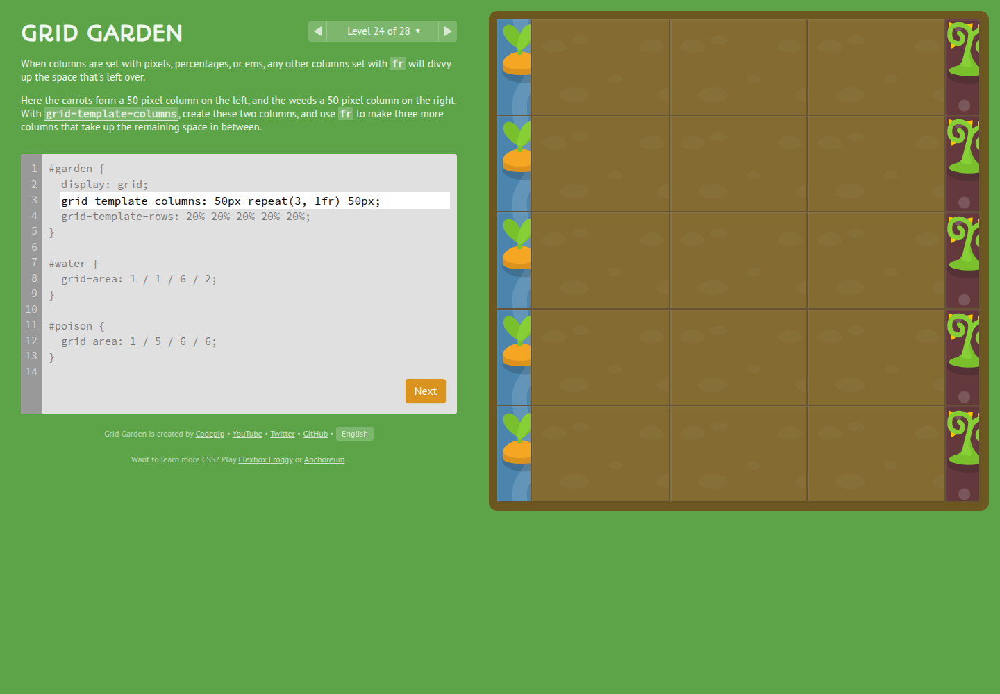

## Level 25

**Mô tả đề bài:** Cột cỏ dại bên trái rộng cố định 75px. Trong phần chiều rộng còn lại, cà rốt chiếm 3/5 và cỏ dại chiếm 2/5. Cần phối hợp đơn vị `px` và `fr` để tạo ba cột tương ứng.

**Cách làm:** Đặt `grid-template-columns: 75px 3fr 2fr;`. CSS Grid dành trước 75px cho cột đầu, rồi chia phần còn lại thành 5 phần: 3 phần cho cột cà rốt ở giữa và 2 phần cho cột cỏ dại bên phải.

```css
#garden {
  display: grid;

  grid-template-columns: 75px 3fr 2fr;
  grid-template-rows: 100%;
}
```

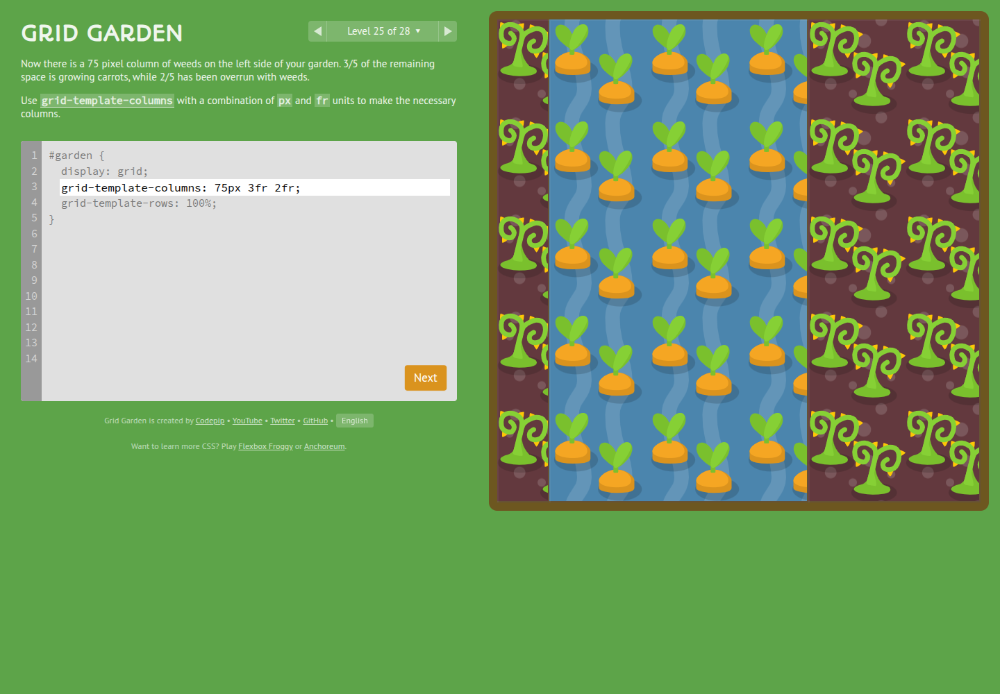

## Level 26

**Mô tả đề bài:** Tưới toàn bộ khu vườn, trừ dải đất cao 50px ở phía trên. Vùng nước đã được cố định tại hàng thứ năm, nên phải tạo đủ năm hàng và phân bố chiều cao phù hợp.

**Cách làm:** Dùng `grid-template-rows: 50px 0 0 0 1fr;`. Hàng đầu dành 50px cho phần đất không tưới; ba hàng giữa có chiều cao bằng 0. Hàng thứ năm nhận toàn bộ chiều cao còn lại nhờ `1fr`, giúp vùng nước phủ đúng phần cà rốt.

```css
#garden {
  display: grid;
  grid-template-columns: 20% 20% 20% 20% 20%;

  grid-template-rows: 50px 0 0 0 1fr;
}

#water {
  grid-column: 1 / 6;
  grid-row: 5 / 6;
}
```

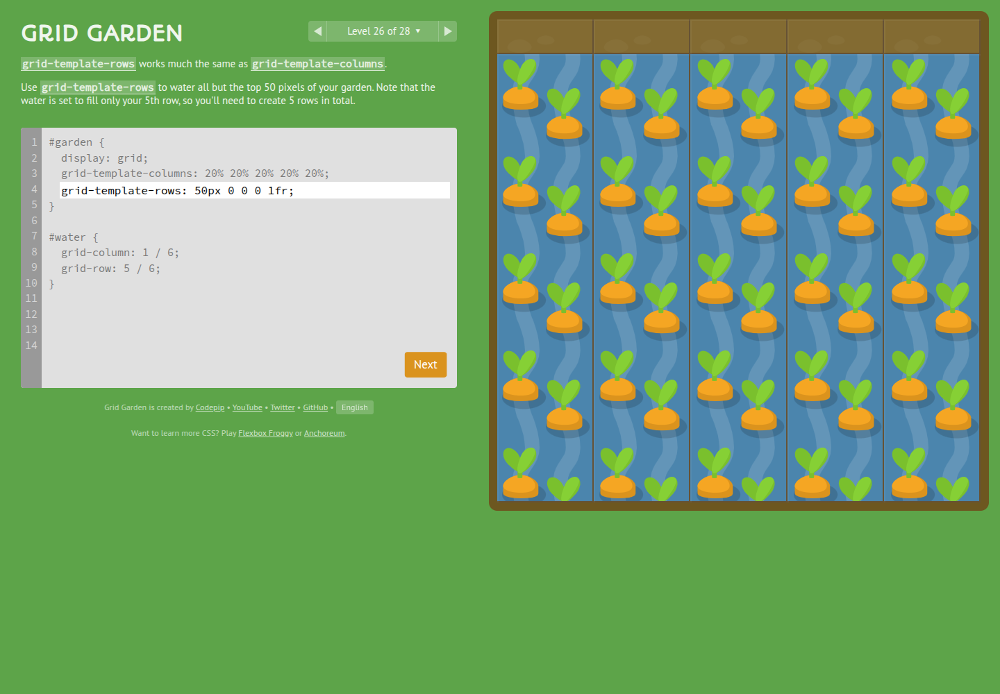

## Level 27

**Mô tả đề bài:** Tưới vùng cà rốt ở góc trên bên trái, có chiều cao bằng 60% khu vườn và chiều rộng 200px. Bài yêu cầu khai báo hàng và cột cùng lúc bằng `grid-template`.

**Cách làm:** Đặt `grid-template: 60% / 200px;`. Phần trước dấu `/` khai báo kích thước hàng, phần sau khai báo kích thước cột. Vùng nước ở hàng 1, cột 1 vì vậy có chiều cao 60% và chiều rộng 200px.

```css
#garden {
  display: grid;

  grid-template: 60% / 200px;
}

#water {
  grid-column: 1;
  grid-row: 1;
}
```

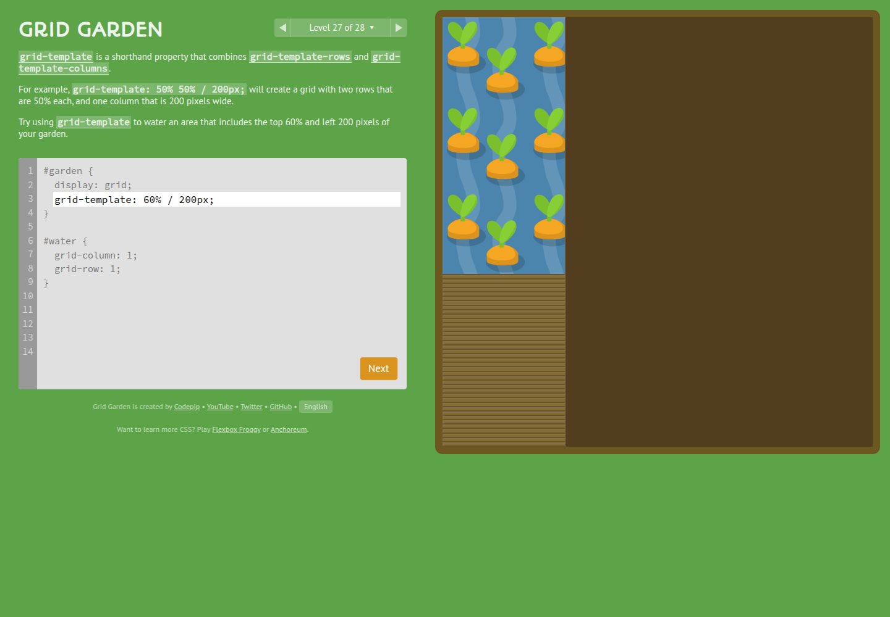

## Level 28

**Mô tả đề bài:** Bài tổng hợp cuối: chừa lối đi cao 50px ở đáy khu vườn; phần còn lại có cỏ dại chiếm 20% chiều rộng bên trái và cà rốt chiếm phần bên phải. Cần đưa thuốc và nước đến đúng hai vùng, tránh lối đi.

**Cách làm:** Dùng `grid-template: 1fr 50px / 20% 1fr;`. Theo chiều dọc, hàng cuối cao cố định 50px, còn hàng đầu nhận toàn bộ phần còn lại. Theo chiều ngang, cột đầu rộng 20% để diệt cỏ, cột thứ hai nhận phần còn lại để tưới cà rốt. Hai vùng xử lý nằm ở hàng đầu nên không tác động lên lối đi.

```css
#garden {
  display: grid;

  grid-template: 1fr 50px / 20% 1fr;
}
```

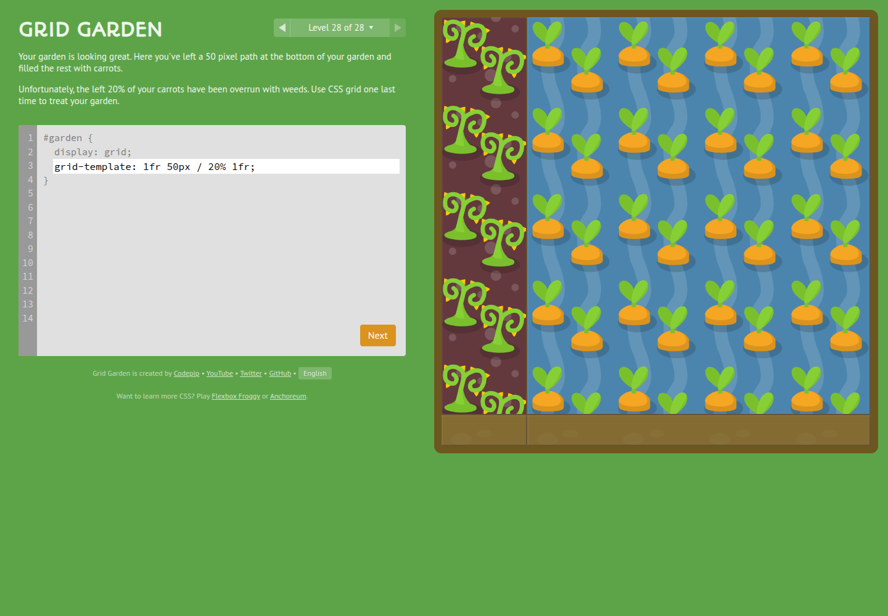

