# Nhóm 3 — Bài 3: CodeCombat — 5 màn đầu Kithgard Dungeon

## 1. Thông tin bài thực hành

- Trò chơi: [CodeCombat](https://codecombat.com/play/dungeon).
- Ngày thực hiện: 23/11/2026.
- Phạm vi báo cáo: **5 màn đầu của Kithgard Dungeon**, từ Dungeons of Kithgard đến True Names.
- Tài khoản: **pumpowhat**.
- Nhân vật: **Captain Anya Weston**.
- Ngôn ngữ lập trình: **JavaScript**.
- Kết quả: **hoàn thành 5/5 màn trong phạm vi báo cáo**; cả 5 màn được game xác nhận thành công.

Mỗi màn bên dưới trình bày yêu cầu, cách giải, mã JavaScript và hai ảnh minh chứng: ảnh mã kèm trạng thái **Goals: Success!**, cùng ảnh thông báo hoàn thành màn. Các ảnh đều được chụp trực tiếp khi chơi lại trên tài khoản `pumpowhat`.

## 2. Bản đồ và tổng hợp kết quả

Bản đồ hiển thị tiến độ **5/44** của toàn bộ khu vực Kithgard Dungeon và các mốc đã hoàn thành. Tên tài khoản `pumpowhat` xuất hiện trong menu My Account ở phía trên bên phải.

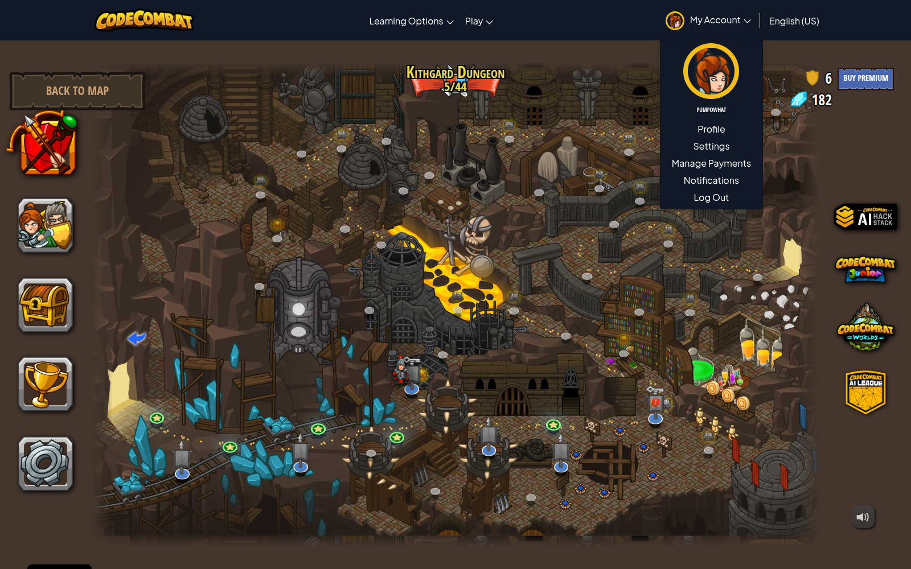

| Màn | Tên màn chơi | Nội dung luyện tập | Kết quả |
|---|---|---|---|
| 1 | Dungeons of Kithgard | Cú pháp gọi phương thức và thực hiện lệnh tuần tự | Thành công |
| 2 | Gems in the Deep | Phối hợp các lệnh di chuyển để thu thập nhiều mục tiêu | Thành công |
| 3 | Shadow Guard | Lập đường đi tránh chướng ngại vật và tầm nhìn của đối thủ | Thành công |
| 4 | Enemy Mine | Dùng đối số số bước để rút gọn mã trong giới hạn 5 dòng | Thành công |
| 5 | True Names | Truyền tên mục tiêu bằng chuỗi và gọi phương thức tấn công | Thành công |

## 3. Nội dung thực hiện từng màn

### Màn 1: Dungeons of Kithgard

**Mô tả đề bài:** Điều khiển nhân vật thu thập viên ngọc cuối hành lang và tránh các bẫy gai.

**Cách làm:** Di chuyển sang phải đến chỗ rẽ, đi xuống rồi đi sang phải để tới viên ngọc. Các lệnh được thực hiện tuần tự theo thứ tự viết trong chương trình.

**Mã JavaScript:**

```javascript
hero.moveRight();
hero.moveDown();
hero.moveRight();
```

**Kết quả:** Game hiển thị **Goals: Success!** và thông báo hoàn thành màn; các mục tiêu của bài được đáp ứng.

**Ảnh mã JavaScript và trạng thái thành công:**

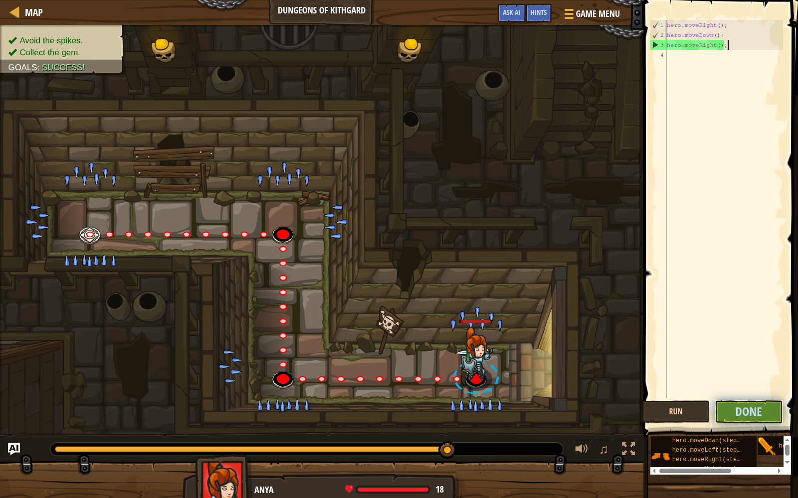

**Ảnh thông báo hoàn thành:**

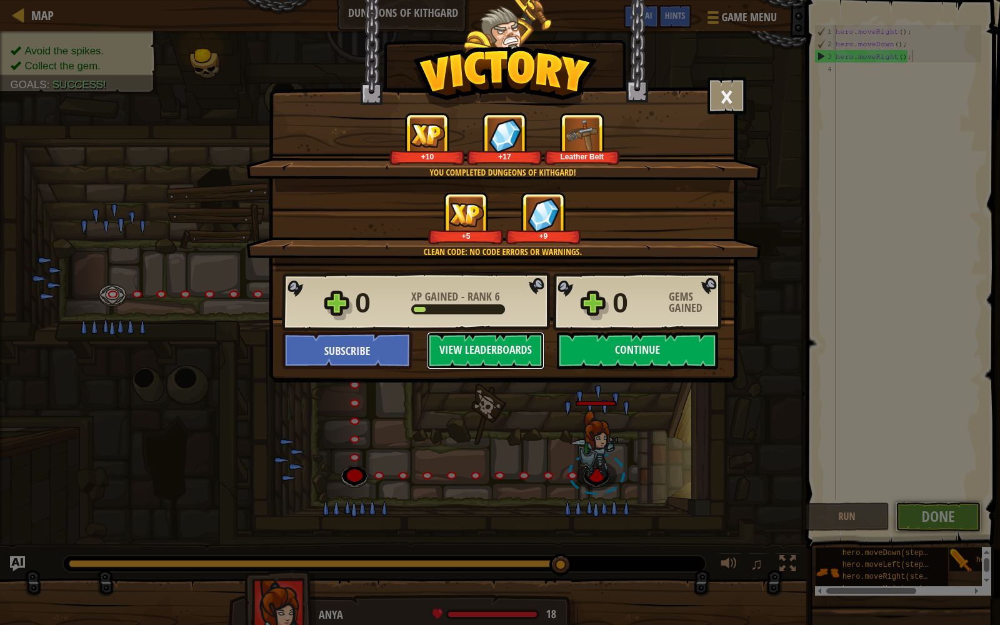

### Màn 2: Gems in the Deep

**Mô tả đề bài:** Thu thập toàn bộ các viên ngọc trên những nhánh hành lang và không chạm bẫy gai.

**Cách làm:** Đi sang phải tới ngã rẽ, xuống nhánh dưới để lấy ngọc, sau đó đi lên hai lần để đến nhánh trên. Cuối cùng đi sang phải để lấy những viên ngọc còn lại.

**Mã JavaScript:**

```javascript
hero.moveRight();
hero.moveDown();
hero.moveUp();
hero.moveUp();
hero.moveRight();
```

**Kết quả:** Game hiển thị **Goals: Success!** và thông báo hoàn thành màn; các mục tiêu của bài được đáp ứng.

**Ảnh mã JavaScript và trạng thái thành công:**

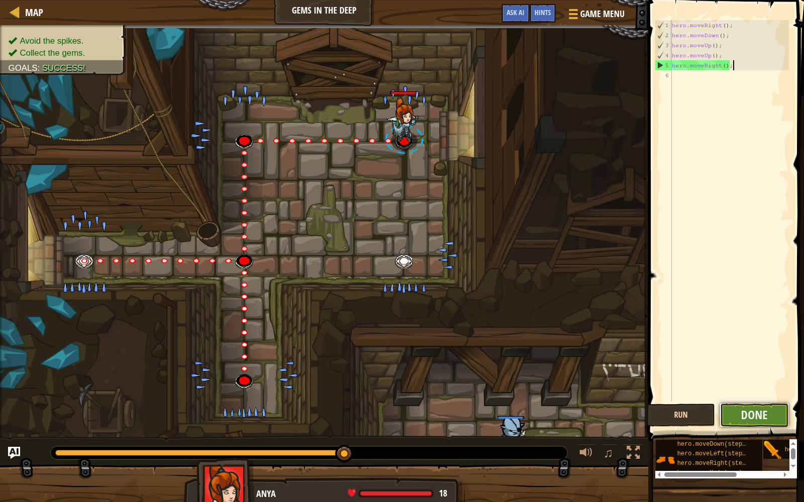

**Ảnh thông báo hoàn thành:**

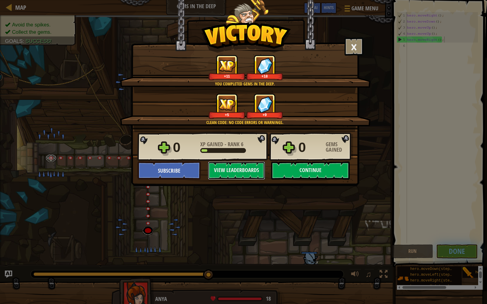

### Màn 3: Shadow Guard

**Mô tả đề bài:** Thu thập các viên ngọc, tránh bẫy gai và không để ogre nhìn thấy nhân vật.

**Cách làm:** Từ điểm xuất phát đi sang phải, vòng lên hành lang phía trên rồi đi sang phải và xuống phía bên kia vật chắn. Tiếp tục sang phải để lấy ngọc, tránh đi ngang qua vùng ogre có thể nhìn thấy.

**Mã JavaScript:**

```javascript
hero.moveRight();
hero.moveUp();
hero.moveRight();
hero.moveDown();
hero.moveRight();
```

**Kết quả:** Game hiển thị **Goals: Success!** và thông báo hoàn thành màn; các mục tiêu của bài được đáp ứng.

**Ảnh mã JavaScript và trạng thái thành công:**

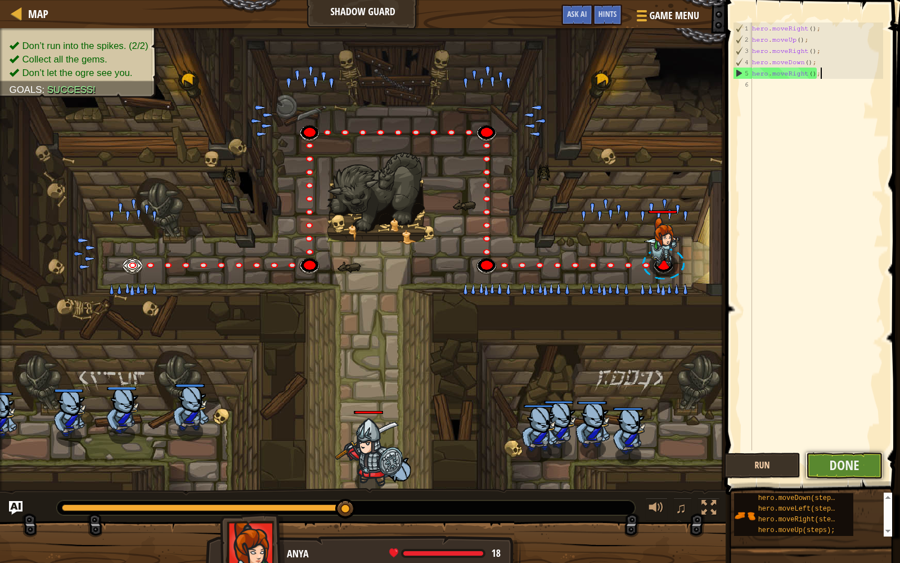

**Ảnh thông báo hoàn thành:**

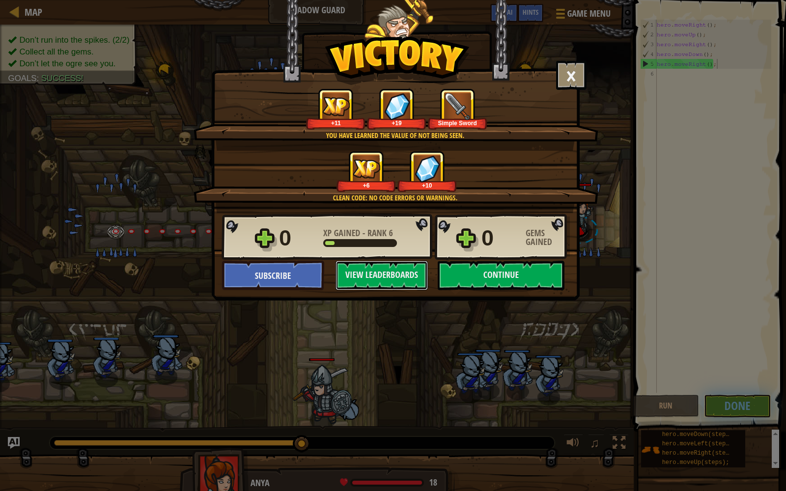

### Màn 4: Enemy Mine

**Mô tả đề bài:** Vượt qua các bẫy lửa, lấy viên ngọc và sử dụng tối đa 5 dòng mã. Khi chạy, game cũng kiểm tra việc dẫn ogre vào bẫy.

**Cách làm:** Dùng đối số số bước để rút gọn các đoạn đường thẳng: sang phải 3 bước, lên 1 bước, sang phải 1 bước, xuống 3 bước và sang phải 2 bước. Chương trình có đúng 5 câu lệnh, hoàn thành các mục tiêu mà game kiểm tra.

**Mã JavaScript:**

```javascript
hero.moveRight(3);
hero.moveUp();
hero.moveRight();
hero.moveDown(3);
hero.moveRight(2);
```

**Kết quả:** Game hiển thị **Goals: Success!** và thông báo hoàn thành màn; các mục tiêu của bài được đáp ứng.

**Ảnh mã JavaScript và trạng thái thành công:**

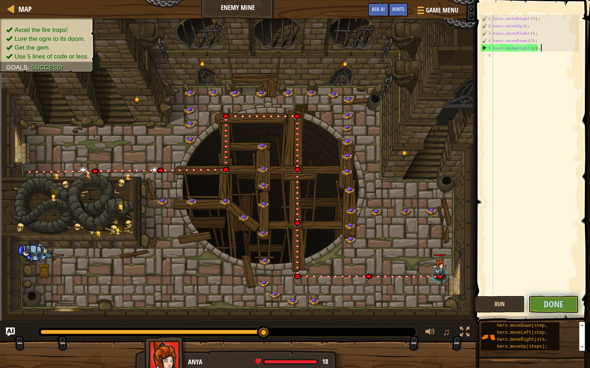

**Ảnh thông báo hoàn thành:**

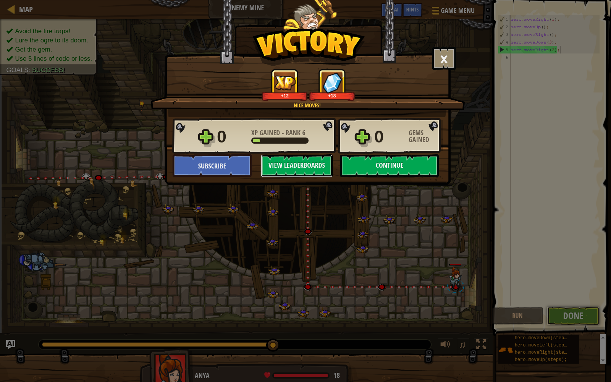

### Màn 5: True Names

**Mô tả đề bài:** Tấn công Brak hai lần, thu thập viên ngọc, tấn công Treg hai lần và bảo đảm nhân vật sống sót.

**Cách làm:** Đi sang phải để tiếp cận Brak rồi gọi `hero.attack("Brak")` hai lần. Tiếp tục sang phải để lấy ngọc, sau đó gọi `hero.attack("Treg")` hai lần. Tên mục tiêu được truyền dưới dạng chuỗi và phải viết đúng chữ hoa, chữ thường.

**Mã JavaScript:**

```javascript
hero.moveRight();
hero.attack("Brak");
hero.attack("Brak");
hero.moveRight();
hero.attack("Treg");
hero.attack("Treg");
```

**Kết quả:** Game hiển thị **Goals: Success!** và thông báo hoàn thành màn; các mục tiêu của bài được đáp ứng.

**Ảnh mã JavaScript và trạng thái thành công:**

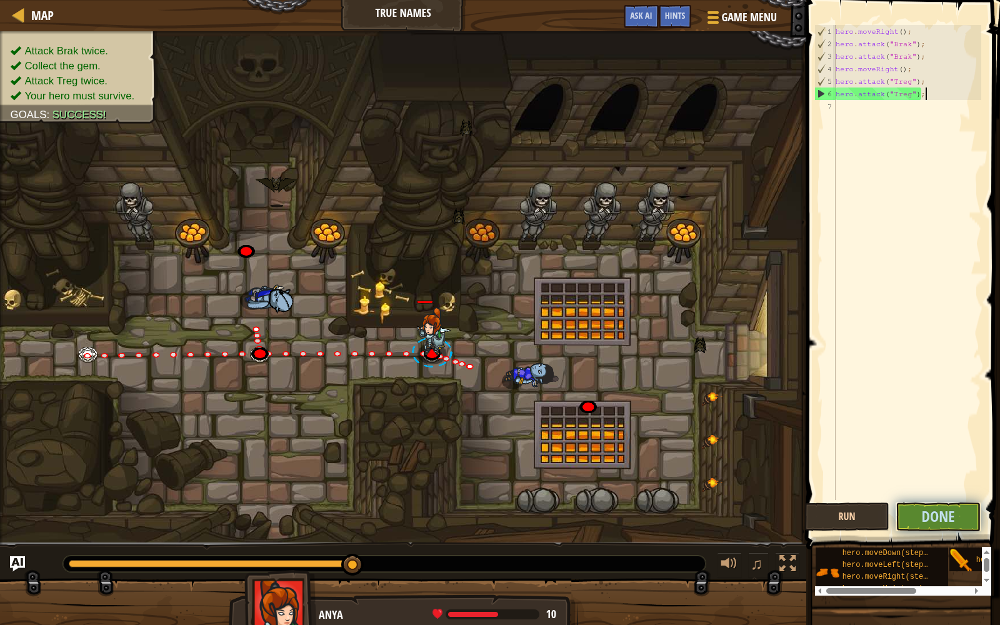

**Ảnh thông báo hoàn thành:**

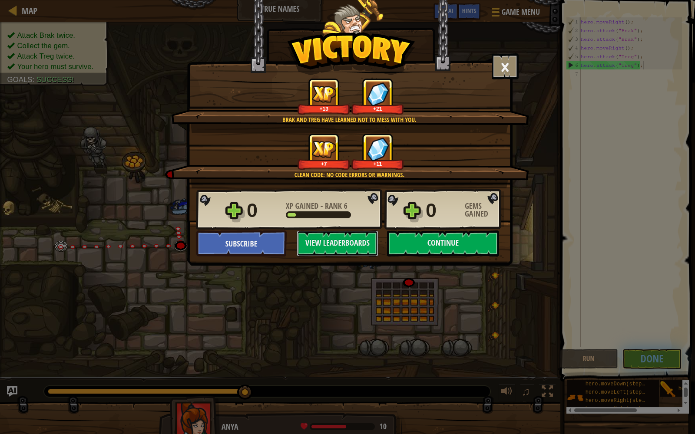

## 4. Kiến thức đã vận dụng

- **Gọi phương thức:** sử dụng cú pháp `hero.tenPhuongThuc(...);` để điều khiển nhân vật.
- **Thực hiện tuần tự:** sắp xếp các câu lệnh theo đúng thứ tự để nhân vật đi theo đường đã chọn.
- **Truyền đối số:** dùng số bước như `hero.moveRight(3);` để di chuyển xa hơn bằng một câu lệnh.
- **Sử dụng chuỗi:** truyền tên mục tiêu trong dấu ngoặc kép, ví dụ `hero.attack("Brak");`, đồng thời chú ý chữ hoa và chữ thường.
- **Kiểm tra kết quả:** đối chiếu mục tiêu của màn với trạng thái Goals và thông báo hoàn thành sau khi chạy mã.
