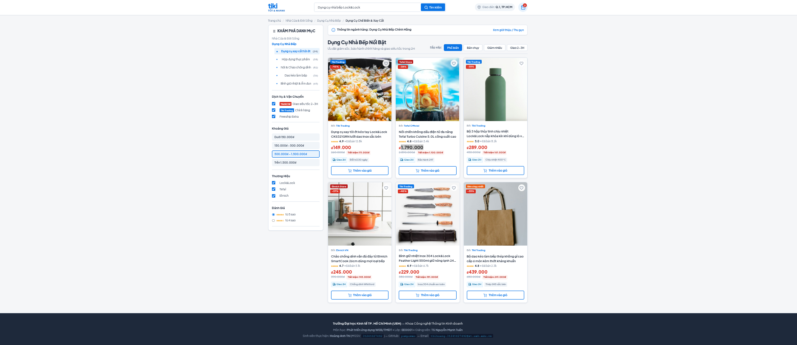
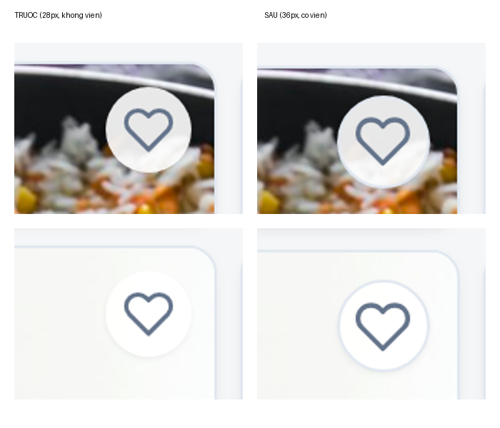
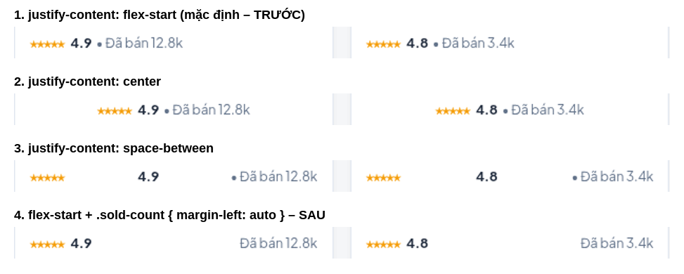
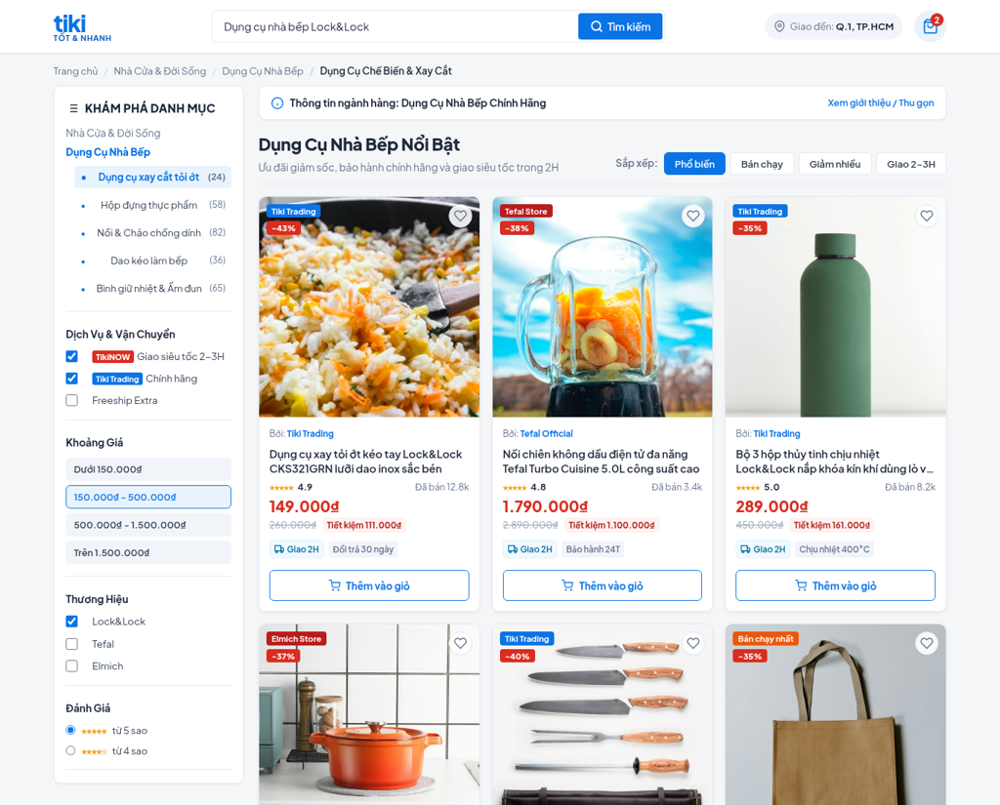
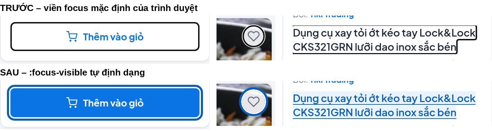
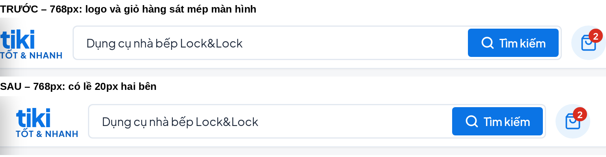
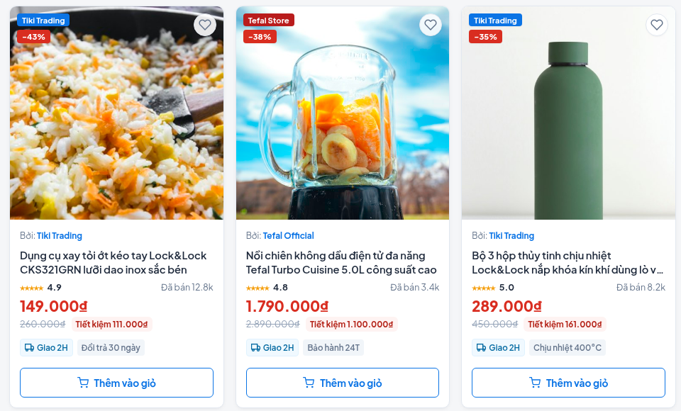
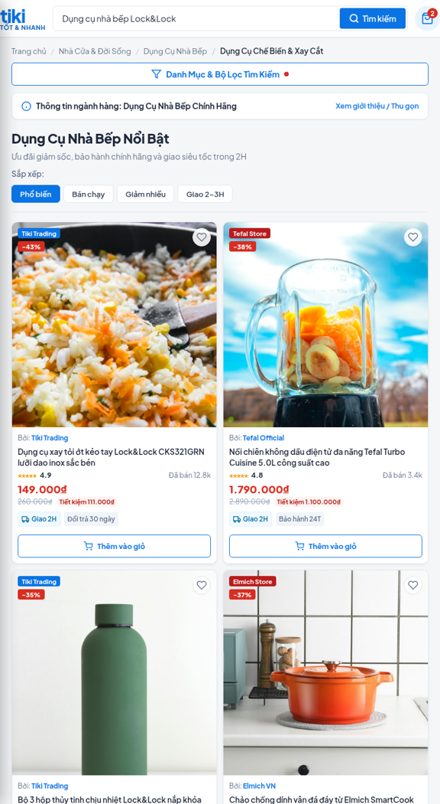
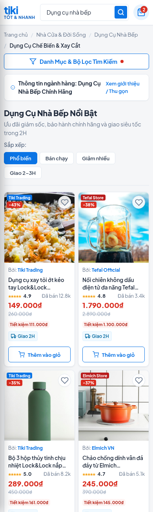

# E-commerce UI Improvement

Bài tập cá nhân **Buổi 2: HTML & CSS** – môn **Phát triển ứng dụng WEB/TMĐT** (UEH). Bài tiếp tục phát triển website của Buổi 1, không tạo website mới.

| | |
|---|---|
| **Họ và tên** | Hoàng Anh Thi |
| **MSSV** | 31241027692 |
| **Lớp** | EE0001 |
| **Giảng viên** | TS Nguyễn Mạnh Tuấn |
| **Repository** | https://github.com/pumpomeo/ecommerce-ui-improvement |
| **Website (GitHub Pages)** | https://pumpomeo.github.io/ecommerce-ui-improvement/ |

## 1. Giới thiệu bài tập
Trang danh mục **Dụng Cụ Nhà Bếp** mô phỏng giao diện Tiki, xây dựng bằng HTML5 và CSS3 ở Buổi 1. Buổi 2 thực hành HTML5 ngữ nghĩa, CSS selector, Box Model, Flexbox, CSS Grid, hover/focus và kiểm thử giao diện trên khu vực đã chọn. Không có backend, cơ sở dữ liệu hay thư viện CSS ngoài (Bootstrap/Tailwind).

## 2. Website tham khảo và khu vực đã cải tiến
- **Website tham khảo:** Tiki – https://tiki.vn/ (ngành hàng Dụng cụ nhà bếp). Đây là giao diện minh họa độc lập, không phải bản sao của Tiki và không kết nối hệ thống Tiki.
- **Khu vực cải tiến:** danh sách sản phẩm và thẻ sản phẩm (`div.product-grid` cùng 6 `article.product-card`; `index.html` dòng 264–629, `css/style.css` dòng 687–983).
- **Khu vực thực hành Flexbox:** hàng đánh giá của thẻ (`div.product-rating`).

## 3. Kỹ thuật HTML5/CSS3 đã thực hành
| Nội dung | Áp dụng trong bài |
|---|---|
| HTML5 ngữ nghĩa | `header`, `nav`, `main`, `section`, `article`, `figure`, `footer`; thứ bậc `h1 → h2`; `del` cho giá gốc; `img` có `alt`; `role="img"` cho cụm sao |
| Tệp CSS riêng | `css/style.css` liên kết bằng `<link rel="stylesheet" href="css/style.css">` |
| Selector | element, class, descendant (`.product-media img`, `.product-card:hover .product-media img`) |
| Box Model | `margin`, `padding`, `border`, `border-radius`, `box-sizing: border-box` |
| Flexbox | `display: flex`, `justify-content`, `align-items`, `gap`, `margin-left: auto` |
| CSS Grid | `display: grid`, `grid-template-columns: repeat(3, 1fr)`, `gap`, `aspect-ratio`, `object-fit: cover`, `@media` |
| Hover / focus | `:hover`, `transition`, `:focus-visible` (kèm kiểm tra độ tương phản WCAG AA) |

## 4. Hướng dẫn chạy website
1. Tải hoặc clone repository: `git clone https://github.com/pumpomeo/ecommerce-ui-improvement.git`
2. Mở thư mục `ecommerce-ui-improvement`.
3. Mở `index.html` bằng Google Chrome (nhấp đúp hoặc chuột phải → Open with).
4. Kiểm tra responsive: nhấn `F12` → `Ctrl + Shift + M` → chọn 1366 px, 768 px hoặc 390 px.

Hoặc xem trực tiếp: https://pumpomeo.github.io/ecommerce-ui-improvement/

## 5. Những thay đổi đã thực hiện trong Buổi 2
| Bước | Thay đổi | Ảnh minh họa |
|---|---|---|
| 2 – HTML5 | `h3.product-title` → `h2.product-title`; giá gốc `span` → `del.price-original`; thêm `role="img"` cho `.stars`; thống nhất giá dạng `149.000₫` |  |
| 4 – Box Model | Nút yêu thích: thêm `border`, tăng 28 px → 36 px trên màn hình ≤ 480 px |  |
| 5 – Flexbox | Thử `justify-content`; chọn `margin-left: auto` cho `.sold-count` |  |
| 6 – Grid | Thử đổi số cột, bỏ `display: grid`, bỏ `object-fit: cover`; giữ `repeat(3, 1fr)` |  |
| 7 – Hover/focus | Thêm `:focus-visible` cho nút và liên kết; đổi màu chữ focus `#0b74e5` → `#085ec0` (5.54:1) |  |
| 8 – Kiểm thử | Sửa lề header ở 481–768 px (`padding: 10px 0` → `padding-bottom: 10px`); sửa dữ liệu SVG icon xe tải |  |

Ảnh trước/sau của Bước 5:  

Ảnh giao diện hoàn thiện:

| 1366 px | 768 px | 390 px |
|---|---|---|
|  |  |  |

## 6. Báo cáo kiểm thử
Kiểm tra bằng Chrome DevTools ở 1366 px, 768 px và 390 px.

| Nội dung kiểm tra | Kết quả | Ghi chú |
|---|---|---|
| Trang HTML mở được | Đạt | Không có thẻ chưa đóng hoặc lồng sai |
| CSS được áp dụng | Đạt | `css/style.css` tải thành công |
| Hình ảnh hiển thị đúng | Chưa đạt | 6 ảnh tải được, đúng tỉ lệ; nhưng nội dung một số ảnh không khớp tên sản phẩm |
| Liên kết hoạt động | Chưa đạt | Liên kết tên sản phẩm, breadcrumb, danh mục là liên kết tạm (`#...`) |
| Bố cục không bị tràn nghiêm trọng | Đạt | Sau khi sửa lỗi header; lưới đúng số cột ở cả 3 kích thước |
| Hover/focus hoạt động | Đạt | Kiểm tra bằng chuột và phím Tab |
| Đã tự sửa ít nhất một vấn đề | Đạt | Lề header 481–768 px; icon xe tải |

Vấn đề chưa sửa (ngoài phạm vi Buổi 2): ảnh không khớp tên sản phẩm; liên kết tạm; thư mục `images/` còn 6 tệp `product-1…6.jpg` không dùng.

## 7. Công cụ AI đã sử dụng và cách kiểm tra kết quả
- **Công cụ:** Claude (Anthropic) – https://claude.ai/
- AI hỗ trợ phân tích mã Buổi 1, giải thích khái niệm, đề xuất đoạn CSS và tìm nguyên nhân lỗi. Em không chép nguyên văn: mọi đề xuất được thử trên trình duyệt và đối chiếu với mã nguồn. Ví dụ: đề xuất `minmax(0, 1fr)` được thử bằng chuỗi dài nhưng không cần thiết; màu focus `#0b74e5` bị đo chỉ đạt 4.02:1 nên đổi sang `#085ec0`.
- Toàn bộ prompt, kết quả và phần tự điều chỉnh: xem [`AI_USAGE.md`](AI_USAGE.md).

## 8. Cấu trúc thư mục
```text
ecommerce-ui-improvement/
├── index.html
├── css/style.css
├── images/
│   ├── kitchen-1.jpg … kitchen-6.jpg   (ảnh sản phẩm đang dùng)
│   ├── product-1.jpg … product-6.jpg   (còn sót từ bản mẫu, không dùng)
│   └── screenshots/                    (ảnh trước/sau, flexbox, grid, hover/focus, header)
├── README.md
└── AI_USAGE.md
```

## 9. Đường dẫn
- Repository: https://github.com/pumpomeo/ecommerce-ui-improvement
- Website: https://pumpomeo.github.io/ecommerce-ui-improvement/
